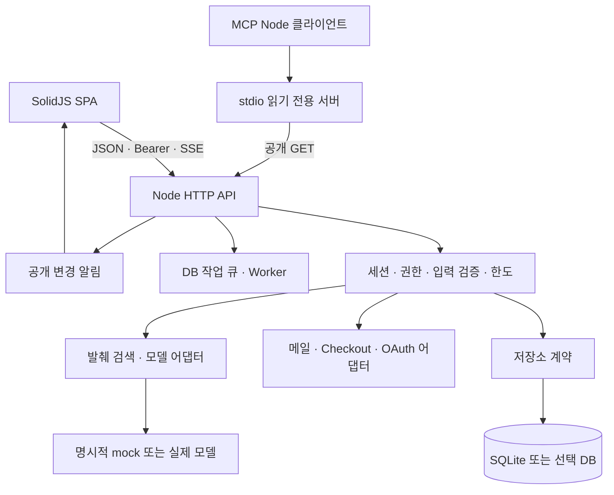

# studyfinal · SolidJS 심화 응용 · Solid Study 서비스 완성

> 기준: [SolidJS 노션 원문](https://app.notion.com/p/40bd7dec5e2e813080f8d54cf5968ad5) · [게시판 API v1](https://app.notion.com/p/3d6d7dec5e2e8139adbfd36dd506c65e) · 문서 기준일 2026-11-20 (Asia/Seoul).

## ① 목표 한 줄

게시판·DB 교체·외부 연동·문서 AI·운영 자동화를 하나의 SolidJS 서비스로 조립한다.

## ② 📖 이론

final은 새 프레임워크를 통합하는 작업이 아니라 midpoint의 계약에 심화 기능을 붙이는 작업이다. 화면은 SolidJS 하나, 서버는 Node 표준 HTTP, 저장소·외부 서비스·모델은 명시적인 어댑터로 연결한다. 기능을 조립할수록 인증·오류·설정·관측 규칙을 공통으로 유지해야 한다.

“완성”은 코드 작성·로컬 실행·외부 계정 검증·배포를 구별해 증거를 남기는 일이다. mock에서 지나간 요청을 실제 결제나 모델 추론 완료로 표시하지 않는다. 외부 Secrets와 원격 저장소가 필요한 작업은 설정과 실제 실행 상태를 각각 기록한다.

## ③ 🛠️ 실기 · 전체 코드와 줄별 설명

이 저장소는 완성 코드와 학습 노트를 함께 제공한다. 아래 파일을 지정 경로에서 읽고 실행한다. 이 단계에서 새로 다루는 파일은 생략 없이 수록하며, import되는 공통 파일은 README와 앞선 단계의 전체 코드를 따른다. 학습 진행 상황은 체크박스에 직접 기록한다.

### 목표

학습 게시판에서 글을 공유하고, 내 문서를 업로드하여 근거 기반 답변을 받으며 운영 가능한 배포·백업 절차를 갖춘다.

### 기능 목록

- midpoint 로그인·글·댓글·검색·페이지·권한.
- PostgreSQL/MariaDB/MongoDB native/ORM 교체와 데이터 이관.
- Solid UI·store·폼, mock/live 결제·메일·OAuth, 검증된 파일 입력.
- 목록 캐시·지연 로딩·Worker 분석·공개 WebSocket 알림.
- 문서 RAG·mock/Anthropic/Ollama 스트리밍·사용량·질문 이력.
- 읽기 전용 MCP 검색·Node 클라이언트, Docker·CI·배포 hook·백업 복구.

### 연동 구성도



### 구현 순서

1. midpoint 기초 시나리오를 통과시키고 API v1·권한 테스트를 고정한다.
2. DB 3종 native/ORM 왕복을 통과시킨다. 기존 데이터는 논리 백업 후 빈 대상에 복원한다.
3. UI 설정 폼과 외부 서비스 어댑터를 연결한다. 기본 mock을 유지한 채 계약·실패 경로부터 검증한다.
4. OpenAPI를 실제 경로와 맞추고 캐시·분석 작업·WebSocket을 추가한다.
5. 문서 소유자 검증→발췌 검색→사용량 예약→모델 스트림→텍스트 렌더→질문 이력 흐름을 연결한다.
6. MCP 서버의 읽기 전용 검색을 실제 Node 클라이언트로 확인한다. 임의 셸 실행이나 개인 문서 조회 도구를 추가하지 않는다.
7. API·UI·브라우저·DB·백업 복구를 검증하고 Docker 이미지를 빌드한다.
8. 원격 Git 저장소에 커밋을 푸시하고 Actions와 배포 호스트를 구성한다. 노션에는 커밋·검증·미완료 외부 설정을 사실대로 반영한다.

### 배포 체크리스트

- [ ] npm ci·문서 검사·API·UI·빌드·브라우저 테스트 통과.
- [ ] DB별 실제 CRUD와 환경변수·ORM 설정 확인.
- [ ] 토큰 만료·작성자 권한·문서 소유자·Origin·XSS·OAuth state 확인.
- [ ] 모델 입력/출력·일일 한도·요청 속도·취소·timeout 확인.
- [ ] API 키·DB 비밀번호·백업·세션 원문이 Git/번들/로그에 없음.
- [ ] Docker health·비root·영속 볼륨·HTTPS·WSS 확인.
- [ ] 빈 DB 복원과 재시작 후 글·문서·질문 기록 복구 확인.
- [ ] 원격 push·Actions 실행·실제 배포 health를 각각 확인.
- [ ] 실제 외부 공급자 거래·모델 품질은 계정 테스트 증거를 남김.

### 최종 회고

반응성: 컴포넌트 마운트와 시그널 갱신을 구분할 수 있는가? 계약: DB를 교체해도 화면이 유지되는 이유는 무엇인가? 보안: UI가 아닌 서버에서 검증한 권한은 무엇인가? 운영: 장애가 났을 때 requestId·백업·롤백으로 어디까지 복구할 수 있는가? AI: 실제 발췌가 답변을 지지하는지 어떻게 검증했는가?

각 질문에 실행 증거와 남은 위험을 함께 기록한다. 이 학습 서비스의 단일 프로세스 JSON 매퍼·간단한 RAG·테스트 Checkout은 실무 완성형이라고 과장하지 않는다.

실행 명령은 저장소 루트의 PowerShell 기준이다. 서버를 유지하는 명령 다음의 작업은 별도 터미널에서 실행한다.

```powershell
npm run check:docs
npm test
npm run test:ui
npm run build
npm run test:e2e
node --test --test-concurrency=1 tests/db-matrix.mjs
docker build -t solid-study:local .
```

### server/app.mjs 전체 코드

[server/app.mjs](server/app.mjs)

```javascript
import { createServer } from 'node:http';
import { readFile, stat } from 'node:fs/promises';
import { resolve, extname, sep } from 'node:path';
import { randomBytes } from 'node:crypto';
import { HttpError, fail, send, requestId, errorResponse, readJson, text, numericId } from './errors.mjs';
import { openStore, repository } from './store.mjs';
import { authenticate, signUp, verifyPassword, publicUser, issueSession, owner, digest, hashPassword } from './auth.mjs';
import { validatePost, postDto, listPosts } from './posts.mjs';
import { streamAnswer } from './ai.mjs';
import { checkout, mail, oauthStart, oauthIdentity } from './integrations.mjs';
import { realtime } from './realtime.mjs';
import { jobRunner } from './jobs.mjs';
import { openapi } from './openapi.mjs';

export function environment(env = process.env) {
  const origin = env.PUBLIC_ORIGIN || 'http://localhost:5173';
  return {
    origin, cors: env.CORS_ORIGIN || origin, ttl: Number(env.SESSION_TTL_SECONDS || 3600),
    aiLimit: Number(env.AI_DAILY_TOKEN_LIMIT || 12000), production: env.NODE_ENV === 'production',
    ai: { provider: env.AI_PROVIDER || 'mock', model: env.AI_MODEL, key: env.ANTHROPIC_API_KEY, version: env.ANTHROPIC_VERSION, ollamaUrl: env.OLLAMA_URL || 'http://127.0.0.1:11434' },
    services: { mode: env.INTEGRATIONS_MODE || 'mock', origin, stripeKey: env.STRIPE_SECRET_KEY, priceId: env.STRIPE_PRICE_ID, mailKey: env.RESEND_API_KEY, mailFrom: env.MAIL_FROM, githubId: env.GITHUB_CLIENT_ID, githubSecret: env.GITHUB_CLIENT_SECRET }
  };
}
export async function createApp(options = {}) {
  const config = options.config || environment();
  const store = options.store || await openStore({ driver: process.env.DB_DRIVER, url: process.env.DATABASE_URL, path: process.env.SQLITE_PATH });
  const repo = repository(store); const cache = new Map(); const rates = new Map();
  let live;
  const changed = () => { cache.clear(); live?.publish({ type: 'posts.changed', at: new Date().toISOString() }); };
  const required = async (bucket, id) => { const row = await repo.get(bucket, id); if (!row) fail(404, 'NOT_FOUND', '자원을 찾을 수 없습니다.'); return row; };
  const limit = (key, count, window = 60000) => {
    const now = Date.now(); let entry = rates.get(key);
    if (!entry || entry.until < now) { entry = { count: 0, until: now + window }; rates.set(key, entry); }
    if (++entry.count > count) fail(429, 'RATE_LIMITED', '잠시 후 다시 시도하세요.');
    if (rates.size > 10000) for (const [k, v] of rates) if (v.until < now) rates.delete(k);
  };
  async function route(req, res, url) {
    const path = url.pathname; const method = req.method;
    const auth = () => authenticate(repo, req.headers.authorization);
    if (path === '/health' && method === 'GET') return send(res, 200, { status: 'ok' });
    if (path === '/api-docs' && method === 'GET') return send(res, 200, openapi);
    if (path === '/api/auth/signup' && method === 'POST') {
      limit(`auth:${req.socket.remoteAddress}`, 20);
      return send(res, 201, { data: publicUser(await signUp(repo, await readJson(req))) });
    }
    if (path === '/api/auth/login' && method === 'POST') {
      limit(`auth:${req.socket.remoteAddress}`, 20);
      const input = await readJson(req); const email = text(input.email, 'email', 254).toLowerCase(); const password = text(input.password, 'password', 128);
      const user = (await repo.all('users')).find(u => u.email === email);
      const valid = await verifyPassword(password, user?.passwordHash || `${'0'.repeat(32)}:${'0'.repeat(128)}`);
      if (!user || !valid) fail(401, 'INVALID_CREDENTIALS', '로그인 정보를 확인하세요.');
      return send(res, 200, { data: await issueSession(repo, user, config.ttl) });
    }
    if (path === '/api/auth/me' && method === 'GET') return send(res, 200, { data: publicUser((await auth()).user) });
    if (path === '/api/auth/logout' && method === 'POST') { const { session } = await auth(); await repo.delete('sessions', session.id); return send(res, 204); }
    if (path === '/api/posts' && method === 'GET') {
      const key = url.search; const hit = cache.get(key);
      res.setHeader('X-Cache', hit && hit.until > Date.now() ? 'HIT' : 'MISS');
      if (hit && hit.until > Date.now()) return send(res, 200, hit.value);
      const value = await listPosts(repo, url.searchParams);
      if (cache.size >= 100) cache.delete(cache.keys().next().value);
      cache.set(key, { value, until: Date.now() + 5000 }); return send(res, 200, value);
    }
    if (path === '/api/posts' && method === 'POST') {
      const { user } = await auth(); const fields = validatePost(await readJson(req)); const now = new Date().toISOString();
      const post = await repo.insert('posts', { ...fields, authorId: user.id, createdAt: now, updatedAt: now });
      changed(); res.setHeader('Location', `/api/posts/${post.id}`); return send(res, 201, { data: await postDto(repo, post) });
    }
    const postPath = path.match(/^\/api\/posts\/([^/]+)$/);
    if (postPath) {
      const id = numericId(postPath[1]); const post = await required('posts', id);
      if (method === 'GET') return send(res, 200, { data: await postDto(repo, post) });
      if (['PATCH', 'DELETE'].includes(method)) {
        const { user } = await auth(); owner(post, user);
        if (method === 'PATCH') {
          const updated = await repo.put('posts', { ...post, ...validatePost(await readJson(req), true), updatedAt: new Date().toISOString() });
          changed(); return send(res, 200, { data: await postDto(repo, updated) });
        }
        for (const comment of await repo.all('comments')) if (comment.postId === id) await repo.delete('comments', comment.id);
        await repo.delete('posts', id); changed(); return send(res, 204);
      }
    }
    const commentsPath = path.match(/^\/api\/posts\/([^/]+)\/comments$/);
    if (commentsPath) {
      const id = numericId(commentsPath[1]); await required('posts', id);
      const dto = async c => ({ id: c.id, body: c.body, createdAt: c.createdAt, author: { id: c.authorId, nickname: (await repo.get('users', c.authorId)).nickname } });
      if (method === 'GET') return send(res, 200, { data: await Promise.all((await repo.all('comments')).filter(c => c.postId === id).map(dto)) });
      if (method === 'POST') {
        const { user } = await auth(); const input = await readJson(req);
        const comment = await repo.insert('comments', { postId: id, authorId: user.id, body: text(input.body, 'body', 2000), createdAt: new Date().toISOString() });
        changed(); return send(res, 201, { data: await dto(comment) });
      }
    }
    const commentPath = path.match(/^\/api\/comments\/([^/]+)$/);
    if (commentPath && method === 'DELETE') {
      const { user } = await auth(); const comment = await required('comments', numericId(commentPath[1])); owner(comment, user);
      await repo.delete('comments', comment.id); changed(); return send(res, 204);
    }
    if (path === '/api/documents') {
      const { user } = await auth();
      if (method === 'GET') return send(res, 200, { data: (await repo.all('documents')).filter(d => d.userId === user.id).map(({ content, ...d }) => d) });
      if (method === 'POST') {
        const input = await readJson(req); const filename = text(input.filename, 'filename', 100);
        if (!/\.(txt|md)$/i.test(filename)) fail(400, 'VALIDATION_ERROR', 'UTF-8 TXT·MD 파일을 사용하세요.');
        const content = text(input.content, 'content', 200000);
        if (Buffer.byteLength(content) > 512000) fail(413, 'PAYLOAD_TOO_LARGE', '파일은 500KB 이하입니다.');
        return send(res, 201, { data: await repo.insert('documents', { filename, content, userId: user.id, createdAt: new Date().toISOString() }) });
      }
    }
    const documentPath = path.match(/^\/api\/documents\/([^/]+)(?:\/(questions|analyze))?$/);
    if (documentPath) {
      const { user } = await auth(); const document = await required('documents', numericId(documentPath[1]));
      if (document.userId !== user.id) fail(403, 'FORBIDDEN', '내 문서만 열 수 있습니다.');
      if (!documentPath[2] && method === 'GET') return send(res, 200, { data: document });
      if (documentPath[2] === 'questions' && method === 'GET') return send(res, 200, { data: (await repo.all('questions')).filter(q => q.documentId === document.id && q.userId === user.id) });
      if (documentPath[2] === 'analyze' && method === 'POST') return send(res, 202, { data: await repo.insert('jobs', { documentId: document.id, userId: user.id, state: 'queued', createdAt: new Date().toISOString() }) });
    }
    const jobPath = path.match(/^\/api\/jobs\/([^/]+)$/);
    if (jobPath && method === 'GET') {
      const { user } = await auth(); const job = await required('jobs', numericId(jobPath[1]));
      if (job.userId !== user.id) fail(403, 'FORBIDDEN', '내 작업만 조회할 수 있습니다.'); return send(res, 200, { data: job });
    }
    if (path === '/api/services/checkout' && method === 'POST') {
      const { user } = await auth(); limit(`checkout:${user.id}`, 5);
      const key = text(req.headers['idempotency-key'], 'idempotency-key', 100);
      return send(res, 200, { data: await checkout(config.services, user, key) });
    }
    if (path === '/api/services/mail' && method === 'POST') {
      const { user } = await auth(); limit(`mail:${user.id}`, 3); return send(res, 200, { data: await mail(config.services, user) });
    }
    if (path === '/api/oauth/start' && method === 'GET') {
      limit(`oauth:${req.socket.remoteAddress}`, 10); const result = await oauthStart(repo, config.services);
      res.setHeader('Set-Cookie', `oauth_state=${result.state}; HttpOnly; SameSite=Lax; Path=/api/oauth; Max-Age=300${config.production ? '; Secure' : ''}`);
      res.statusCode = 302; res.setHeader('Location', result.url); return res.end();
    }
    if (path === '/api/oauth/callback' && method === 'GET') {
      const state = url.searchParams.get('state') || ''; const cookie = req.headers.cookie?.split(';').map(c => c.trim()).find(c => c.startsWith('oauth_state='))?.slice(12);
      const saved = (await repo.all('oauthStates')).find(s => s.hash === digest(state) && s.expiresAt > Date.now());
      if (!cookie || cookie !== state || !saved) fail(400, 'BAD_REQUEST', 'OAuth state 검증 실패');
      await repo.delete('oauthStates', saved.id);
      const identity = await oauthIdentity(config.services, url.searchParams.get('code'));
      let user = (await repo.all('users')).find(u => u.githubId === String(identity.id));
      if (!user) user = await repo.insert('users', { email: `github-${identity.id}@oauth.invalid`, githubId: String(identity.id), nickname: String(identity.login).slice(0, 40), passwordHash: await hashPassword(randomBytes(32).toString('hex')) });
      const exchangeCode = randomBytes(32).toString('base64url');
      await repo.insert('oauthCodes', { hash: digest(exchangeCode), userId: user.id, expiresAt: Date.now() + 60000 });
      res.setHeader('Set-Cookie', 'oauth_state=; HttpOnly; SameSite=Lax; Path=/api/oauth; Max-Age=0');
      res.statusCode = 302; res.setHeader('Location', `${config.origin}/login?code=${exchangeCode}`); return res.end();
    }
    if (path === '/api/oauth/exchange' && method === 'POST') {
      const input = await readJson(req); const code = text(input.code, 'code', 100);
      const saved = (await repo.all('oauthCodes')).find(s => s.hash === digest(code) && s.expiresAt > Date.now());
      if (!saved) fail(401, 'UNAUTHORIZED', '일회용 코드가 만료되었습니다.');
      await repo.delete('oauthCodes', saved.id); return send(res, 200, { data: await issueSession(repo, await required('users', saved.userId), config.ttl) });
    }
    if (!path.startsWith('/api') && !path.startsWith('/health') && method === 'GET') {
      const root = resolve('dist'); let file;
      try { file = resolve(root, `.${decodeURIComponent(path)}`); } catch { fail(400, 'BAD_REQUEST', '잘못된 경로입니다.'); }
      if (file !== root && !file.startsWith(root + sep)) fail(404, 'NOT_FOUND', '없는 경로입니다.');
      let info; try { info = await stat(file); } catch {}
      if (!info?.isFile()) { if (extname(path)) fail(404, 'NOT_FOUND', '파일을 찾을 수 없습니다.'); file = resolve(root, 'index.html'); }
      try {
        const content = await readFile(file); res.setHeader('Content-Type', ({ '.html': 'text/html; charset=utf-8', '.js': 'text/javascript', '.css': 'text/css' })[extname(file)] || 'application/octet-stream');
        res.setHeader('Cache-Control', file.includes(`${sep}assets${sep}`) ? 'public,max-age=31536000,immutable' : 'no-cache'); res.end(content); return;
      } catch { fail(404, 'NOT_FOUND', 'npm run build 후 화면을 제공할 수 있습니다.'); }
    }
    fail(404, 'NOT_FOUND', '없는 경로입니다.');
  }
  const server = createServer(async (req, res) => {
    const id = requestId(req); const start = performance.now(); const url = new URL(req.url, 'http://localhost');
    res.setHeader('X-Request-Id', id); res.setHeader('X-Content-Type-Options', 'nosniff'); res.setHeader('Referrer-Policy', 'no-referrer');
    res.setHeader('Content-Security-Policy', "default-src 'self'; script-src 'self'; style-src 'self' 'unsafe-inline'; connect-src 'self' ws: wss:; object-src 'none'; frame-ancestors 'none'; base-uri 'self'");
    res.on('finish', () => { if (!options.quiet) console.log(JSON.stringify({ requestId: id, method: req.method, path: url.pathname, status: res.statusCode, durationMs: Math.round(performance.now() - start) })); });
    try {
      const origin = req.headers.origin;
      if (origin && origin !== config.cors && origin !== config.origin) fail(403, 'FORBIDDEN', '허용되지 않은 Origin입니다.');
      if (origin) { res.setHeader('Access-Control-Allow-Origin', origin); res.setHeader('Vary', 'Origin'); }
      res.setHeader('Access-Control-Expose-Headers', 'X-Request-Id, Location, X-Cache');
      if (req.method === 'OPTIONS') {
        res.setHeader('Access-Control-Allow-Methods', 'GET,POST,PATCH,DELETE,OPTIONS');
        res.setHeader('Access-Control-Allow-Headers', 'Content-Type,Authorization,X-Request-Id,Idempotency-Key'); return send(res, 204);
      }
      limit(`global:${req.socket.remoteAddress}`, 300);
      if (req.method === 'POST' && url.pathname === '/api/ai/chat/stream') {
        const { user } = await authenticate(repo, req.headers.authorization); limit(`ai:${user.id}`, 10);
        const input = await readJson(req); const document = await required('documents', numericId(String(input.documentId)));
        if (document.userId !== user.id) fail(403, 'FORBIDDEN', '내 문서만 사용할 수 있습니다.');
        return await streamAnswer({ req, res, repo, user, document, input, config });
      }
      // 스트림은 별도 처리하고, 그 밖의 요청은 데이터 변경과 조회를 일관되게 직렬화한다.
      await repo.serial(() => route(req, res, url));
    } catch (error) {
      if (!(error instanceof HttpError) && !options.quiet) console.error(JSON.stringify({ requestId: id, code: 'INTERNAL', type: error.name }));
      errorResponse(res, error, id);
    }
  });
  server.requestTimeout = 20000; server.headersTimeout = 10000;
  live = realtime(server, config.origin); const jobs = jobRunner(repo); await jobs.recover();
  return { server, repo, close: async () => { live.close(); await new Promise(resolve => { server.close(resolve); server.closeIdleConnections(); }); await jobs.stop(); await store.close(); } };
}
```

줄 번호는 바로 위 코드의 첫 줄을 1로 센다. 빈 줄도 포함하여 실제 파일과 일치한다.

| 줄 | 해당 코드 | 설명 |
| --- | --- | --- |
| 1 | <code>import { createServer } from &#x27;node:http&#x27;;</code> | node:http에서 이 파일의 실행에 필요한 기능·타입을 가져온다. |
| 2 | <code>import { readFile, stat } from &#x27;node:fs/promises&#x27;;</code> | node:fs/promises에서 이 파일의 실행에 필요한 기능·타입을 가져온다. |
| 3 | <code>import { resolve, extname, sep } from &#x27;node:path&#x27;;</code> | node:path에서 이 파일의 실행에 필요한 기능·타입을 가져온다. |
| 4 | <code>import { randomBytes } from &#x27;node:crypto&#x27;;</code> | node:crypto에서 이 파일의 실행에 필요한 기능·타입을 가져온다. |
| 5 | <code>import { HttpError, fail, send, requestId, errorResponse, readJson, text, numericId } from &#x27;./errors.mjs&#x27;;</code> | ./errors.mjs에서 이 파일의 실행에 필요한 기능·타입을 가져온다. |
| 6 | <code>import { openStore, repository } from &#x27;./store.mjs&#x27;;</code> | ./store.mjs에서 이 파일의 실행에 필요한 기능·타입을 가져온다. |
| 7 | <code>import { authenticate, signUp, verifyPassword, publicUser, issueSession, owner, digest, hashPassword } from &#x27;./auth.mjs&#x27;;</code> | ./auth.mjs에서 이 파일의 실행에 필요한 기능·타입을 가져온다. |
| 8 | <code>import { validatePost, postDto, listPosts } from &#x27;./posts.mjs&#x27;;</code> | ./posts.mjs에서 이 파일의 실행에 필요한 기능·타입을 가져온다. |
| 9 | <code>import { streamAnswer } from &#x27;./ai.mjs&#x27;;</code> | ./ai.mjs에서 이 파일의 실행에 필요한 기능·타입을 가져온다. |
| 10 | <code>import { checkout, mail, oauthStart, oauthIdentity } from &#x27;./integrations.mjs&#x27;;</code> | ./integrations.mjs에서 이 파일의 실행에 필요한 기능·타입을 가져온다. |
| 11 | <code>import { realtime } from &#x27;./realtime.mjs&#x27;;</code> | ./realtime.mjs에서 이 파일의 실행에 필요한 기능·타입을 가져온다. |
| 12 | <code>import { jobRunner } from &#x27;./jobs.mjs&#x27;;</code> | ./jobs.mjs에서 이 파일의 실행에 필요한 기능·타입을 가져온다. |
| 13 | <code>import { openapi } from &#x27;./openapi.mjs&#x27;;</code> | ./openapi.mjs에서 이 파일의 실행에 필요한 기능·타입을 가져온다. |
| 14 | <code>(빈 줄)</code> | 빈 줄로 논리 단위를 구분한다. |
| 15 | <code>export function environment(env = process.env) {</code> | 심화 API 조립과 보안 경계의 이름 있는 동작과 인자 범위를 정의한다. |
| 16 | <code>  const origin = env.PUBLIC_ORIGIN &#124;&#124; &#x27;http://localhost:5173&#x27;;</code> | 심화 API 조립과 보안 경계에서 다음 처리에 사용할 값·함수·상태 참조를 준비한다. |
| 17 | <code>  return {</code> | 심화 API 조립과 보안 경계의 현재 처리 결과를 호출자에게 돌려준다. |
| 18 | <code>    origin, cors: env.CORS_ORIGIN &#124;&#124; origin, ttl: Number(env.SESSION_TTL_SECONDS &#124;&#124; 3600),</code> | 심화 API 조립과 보안 경계의 앞서 선언한 데이터·객체·출력 구조에 이 줄의 값을 연결한다. |
| 19 | <code>    aiLimit: Number(env.AI_DAILY_TOKEN_LIMIT &#124;&#124; 12000), production: env.NODE_ENV === &#x27;production&#x27;,</code> | 심화 API 조립과 보안 경계의 앞서 선언한 데이터·객체·출력 구조에 이 줄의 값을 연결한다. |
| 20 | <code>    ai: { provider: env.AI_PROVIDER &#124;&#124; &#x27;mock&#x27;, model: env.AI_MODEL, key: env.ANTHROPIC_API_KEY, version: env.ANTHROPIC_VERSION, ollamaUrl: env.OLLAMA_URL &#124;&#124; &#x27;http://127.0.0.1:11434&#x27; },</code> | 심화 API 조립과 보안 경계의 앞서 선언한 데이터·객체·출력 구조에 이 줄의 값을 연결한다. |
| 21 | <code>    services: { mode: env.INTEGRATIONS_MODE &#124;&#124; &#x27;mock&#x27;, origin, stripeKey: env.STRIPE_SECRET_KEY, priceId: env.STRIPE_PRICE_ID, mailKey: env.RESEND_API_KEY, mailFrom: env.MAIL_FROM, githubId: env.GITHUB_CLIENT_ID, githubSecret: env.GITHUB_CLIENT_SECRET }</code> | 심화 API 조립과 보안 경계의 앞서 선언한 데이터·객체·출력 구조에 이 줄의 값을 연결한다. |
| 22 | <code>  };</code> | 심화 API 조립과 보안 경계의 현재 블록 또는 선언을 닫는다. |
| 23 | <code>}</code> | 심화 API 조립과 보안 경계의 현재 블록 또는 선언을 닫는다. |
| 24 | <code>export async function createApp(options = {}) {</code> | 심화 API 조립과 보안 경계의 이름 있는 동작과 인자 범위를 정의한다. |
| 25 | <code>  const config = options.config &#124;&#124; environment();</code> | 심화 API 조립과 보안 경계에서 다음 처리에 사용할 값·함수·상태 참조를 준비한다. |
| 26 | <code>  const store = options.store &#124;&#124; await openStore({ driver: process.env.DB_DRIVER, url: process.env.DATABASE_URL, path: process.env.SQLITE_PATH });</code> | 심화 API 조립과 보안 경계에서 다음 처리에 사용할 값·함수·상태 참조를 준비한다. |
| 27 | <code>  const repo = repository(store); const cache = new Map(); const rates = new Map();</code> | 심화 API 조립과 보안 경계에서 다음 처리에 사용할 값·함수·상태 참조를 준비한다. |
| 28 | <code>  let live;</code> | 심화 API 조립과 보안 경계에서 다음 처리에 사용할 값·함수·상태 참조를 준비한다. |
| 29 | <code>  const changed = () =&gt; { cache.clear(); live?.publish({ type: &#x27;posts.changed&#x27;, at: new Date().toISOString() }); };</code> | 심화 API 조립과 보안 경계에서 다음 처리에 사용할 값·함수·상태 참조를 준비한다. |
| 30 | <code>  const required = async (bucket, id) =&gt; { const row = await repo.get(bucket, id); if (!row) fail(404, &#x27;NOT_FOUND&#x27;, &#x27;자원을 찾을 수 없습니다.&#x27;); return row; };</code> | 심화 API 조립과 보안 경계: id에 해당하는 저장 레코드를 조회한다. |
| 31 | <code>  const limit = (key, count, window = 60000) =&gt; {</code> | 심화 API 조립과 보안 경계에서 다음 처리에 사용할 값·함수·상태 참조를 준비한다. |
| 32 | <code>    const now = Date.now(); let entry = rates.get(key);</code> | 심화 API 조립과 보안 경계에서 다음 처리에 사용할 값·함수·상태 참조를 준비한다. |
| 33 | <code>    if (!entry &#124;&#124; entry.until &lt; now) { entry = { count: 0, until: now + window }; rates.set(key, entry); }</code> | 심화 API 조립과 보안 경계에서 조건에 따라 처리 경로를 선택하거나 조기 종료한다. |
| 34 | <code>    if (++entry.count &gt; count) fail(429, &#x27;RATE_LIMITED&#x27;, &#x27;잠시 후 다시 시도하세요.&#x27;);</code> | 심화 API 조립과 보안 경계: 규칙 위반을 HTTP 상태·code·필드 오류로 중단한다. |
| 35 | <code>    if (rates.size &gt; 10000) for (const [k, v] of rates) if (v.until &lt; now) rates.delete(k);</code> | 심화 API 조립과 보안 경계에서 조건에 따라 처리 경로를 선택하거나 조기 종료한다. |
| 36 | <code>  };</code> | 심화 API 조립과 보안 경계의 현재 블록 또는 선언을 닫는다. |
| 37 | <code>  async function route(req, res, url) {</code> | 심화 API 조립과 보안 경계의 이름 있는 동작과 인자 범위를 정의한다. |
| 38 | <code>    const path = url.pathname; const method = req.method;</code> | 심화 API 조립과 보안 경계에서 다음 처리에 사용할 값·함수·상태 참조를 준비한다. |
| 39 | <code>    const auth = () =&gt; authenticate(repo, req.headers.authorization);</code> | 심화 API 조립과 보안 경계: Bearer 세션 해시·만료·사용자를 서버에서 확인한다. |
| 40 | <code>    if (path === &#x27;/health&#x27; &amp;&amp; method === &#x27;GET&#x27;) return send(res, 200, { status: &#x27;ok&#x27; });</code> | 심화 API 조립과 보안 경계: 현재 분기의 상태 코드와 JSON 또는 빈 응답을 전송한다. |
| 41 | <code>    if (path === &#x27;/api-docs&#x27; &amp;&amp; method === &#x27;GET&#x27;) return send(res, 200, openapi);</code> | 심화 API 조립과 보안 경계: 현재 분기의 상태 코드와 JSON 또는 빈 응답을 전송한다. |
| 42 | <code>    if (path === &#x27;/api/auth/signup&#x27; &amp;&amp; method === &#x27;POST&#x27;) {</code> | 심화 API 조립과 보안 경계에서 조건에 따라 처리 경로를 선택하거나 조기 종료한다. |
| 43 | <code>      limit(`auth:${req.socket.remoteAddress}`, 20);</code> | 심화 API 조립과 보안 경계의 앞서 선언한 데이터·객체·출력 구조에 이 줄의 값을 연결한다. |
| 44 | <code>      return send(res, 201, { data: publicUser(await signUp(repo, await readJson(req))) });</code> | 심화 API 조립과 보안 경계: 현재 분기의 상태 코드와 JSON 또는 빈 응답을 전송한다. |
| 45 | <code>    }</code> | 심화 API 조립과 보안 경계의 현재 블록 또는 선언을 닫는다. |
| 46 | <code>    if (path === &#x27;/api/auth/login&#x27; &amp;&amp; method === &#x27;POST&#x27;) {</code> | 심화 API 조립과 보안 경계에서 조건에 따라 처리 경로를 선택하거나 조기 종료한다. |
| 47 | <code>      limit(`auth:${req.socket.remoteAddress}`, 20);</code> | 심화 API 조립과 보안 경계의 앞서 선언한 데이터·객체·출력 구조에 이 줄의 값을 연결한다. |
| 48 | <code>      const input = await readJson(req); const email = text(input.email, &#x27;email&#x27;, 254).toLowerCase(); const password = text(input.password, &#x27;password&#x27;, 128);</code> | 심화 API 조립과 보안 경계에서 다음 처리에 사용할 값·함수·상태 참조를 준비한다. |
| 49 | <code>      const user = (await repo.all(&#x27;users&#x27;)).find(u =&gt; u.email === email);</code> | 심화 API 조립과 보안 경계: bucket의 레코드를 읽어 검증·필터·조회에 사용한다. |
| 50 | <code>      const valid = await verifyPassword(password, user?.passwordHash &#124;&#124; `${&#x27;0&#x27;.repeat(32)}:${&#x27;0&#x27;.repeat(128)}`);</code> | 심화 API 조립과 보안 경계에서 다음 처리에 사용할 값·함수·상태 참조를 준비한다. |
| 51 | <code>      if (!user &#124;&#124; !valid) fail(401, &#x27;INVALID_CREDENTIALS&#x27;, &#x27;로그인 정보를 확인하세요.&#x27;);</code> | 심화 API 조립과 보안 경계: 규칙 위반을 HTTP 상태·code·필드 오류로 중단한다. |
| 52 | <code>      return send(res, 200, { data: await issueSession(repo, user, config.ttl) });</code> | 심화 API 조립과 보안 경계: 현재 분기의 상태 코드와 JSON 또는 빈 응답을 전송한다. |
| 53 | <code>    }</code> | 심화 API 조립과 보안 경계의 현재 블록 또는 선언을 닫는다. |
| 54 | <code>    if (path === &#x27;/api/auth/me&#x27; &amp;&amp; method === &#x27;GET&#x27;) return send(res, 200, { data: publicUser((await auth()).user) });</code> | 심화 API 조립과 보안 경계: 현재 분기의 상태 코드와 JSON 또는 빈 응답을 전송한다. |
| 55 | <code>    if (path === &#x27;/api/auth/logout&#x27; &amp;&amp; method === &#x27;POST&#x27;) { const { session } = await auth(); await repo.delete(&#x27;sessions&#x27;, session.id); return send(res, 204); }</code> | 심화 API 조립과 보안 경계: 지정한 bucket과 id의 레코드를 제거한다. |
| 56 | <code>    if (path === &#x27;/api/posts&#x27; &amp;&amp; method === &#x27;GET&#x27;) {</code> | 심화 API 조립과 보안 경계에서 조건에 따라 처리 경로를 선택하거나 조기 종료한다. |
| 57 | <code>      const key = url.search; const hit = cache.get(key);</code> | 심화 API 조립과 보안 경계에서 다음 처리에 사용할 값·함수·상태 참조를 준비한다. |
| 58 | <code>      res.setHeader(&#x27;X-Cache&#x27;, hit &amp;&amp; hit.until &gt; Date.now() ? &#x27;HIT&#x27; : &#x27;MISS&#x27;);</code> | 심화 API 조립과 보안 경계: HTTP 응답의 보안·형식·추적·캐시 헤더를 설정한다. |
| 59 | <code>      if (hit &amp;&amp; hit.until &gt; Date.now()) return send(res, 200, hit.value);</code> | 심화 API 조립과 보안 경계: 현재 분기의 상태 코드와 JSON 또는 빈 응답을 전송한다. |
| 60 | <code>      const value = await listPosts(repo, url.searchParams);</code> | 심화 API 조립과 보안 경계에서 다음 처리에 사용할 값·함수·상태 참조를 준비한다. |
| 61 | <code>      if (cache.size &gt;= 100) cache.delete(cache.keys().next().value);</code> | 심화 API 조립과 보안 경계에서 조건에 따라 처리 경로를 선택하거나 조기 종료한다. |
| 62 | <code>      cache.set(key, { value, until: Date.now() + 5000 }); return send(res, 200, value);</code> | 심화 API 조립과 보안 경계: 현재 분기의 상태 코드와 JSON 또는 빈 응답을 전송한다. |
| 63 | <code>    }</code> | 심화 API 조립과 보안 경계의 현재 블록 또는 선언을 닫는다. |
| 64 | <code>    if (path === &#x27;/api/posts&#x27; &amp;&amp; method === &#x27;POST&#x27;) {</code> | 심화 API 조립과 보안 경계에서 조건에 따라 처리 경로를 선택하거나 조기 종료한다. |
| 65 | <code>      const { user } = await auth(); const fields = validatePost(await readJson(req)); const now = new Date().toISOString();</code> | 심화 API 조립과 보안 경계: title·body·tags가 공통 게시글 입력 규칙을 만족하는지 검사한다. |
| 66 | <code>      const post = await repo.insert(&#x27;posts&#x27;, { ...fields, authorId: user.id, createdAt: now, updatedAt: now });</code> | 심화 API 조립과 보안 경계: 도메인 레코드에 숫자 id를 부여하여 저장한다. |
| 67 | <code>      changed(); res.setHeader(&#x27;Location&#x27;, `/api/posts/${post.id}`); return send(res, 201, { data: await postDto(repo, post) });</code> | 심화 API 조립과 보안 경계: HTTP 응답의 보안·형식·추적·캐시 헤더를 설정한다. |
| 68 | <code>    }</code> | 심화 API 조립과 보안 경계의 현재 블록 또는 선언을 닫는다. |
| 69 | <code>    const postPath = path.match(/^\/api\/posts\/([^/]+)$/);</code> | 심화 API 조립과 보안 경계에서 다음 처리에 사용할 값·함수·상태 참조를 준비한다. |
| 70 | <code>    if (postPath) {</code> | 심화 API 조립과 보안 경계에서 조건에 따라 처리 경로를 선택하거나 조기 종료한다. |
| 71 | <code>      const id = numericId(postPath[1]); const post = await required(&#x27;posts&#x27;, id);</code> | 심화 API 조립과 보안 경계에서 다음 처리에 사용할 값·함수·상태 참조를 준비한다. |
| 72 | <code>      if (method === &#x27;GET&#x27;) return send(res, 200, { data: await postDto(repo, post) });</code> | 심화 API 조립과 보안 경계: 현재 분기의 상태 코드와 JSON 또는 빈 응답을 전송한다. |
| 73 | <code>      if ([&#x27;PATCH&#x27;, &#x27;DELETE&#x27;].includes(method)) {</code> | 심화 API 조립과 보안 경계에서 조건에 따라 처리 경로를 선택하거나 조기 종료한다. |
| 74 | <code>        const { user } = await auth(); owner(post, user);</code> | 심화 API 조립과 보안 경계: 현재 사용자와 작성자를 비교하여 변경 권한을 확인한다. |
| 75 | <code>        if (method === &#x27;PATCH&#x27;) {</code> | 심화 API 조립과 보안 경계에서 조건에 따라 처리 경로를 선택하거나 조기 종료한다. |
| 76 | <code>          const updated = await repo.put(&#x27;posts&#x27;, { ...post, ...validatePost(await readJson(req), true), updatedAt: new Date().toISOString() });</code> | 심화 API 조립과 보안 경계: title·body·tags가 공통 게시글 입력 규칙을 만족하는지 검사한다. |
| 77 | <code>          changed(); return send(res, 200, { data: await postDto(repo, updated) });</code> | 심화 API 조립과 보안 경계: 현재 분기의 상태 코드와 JSON 또는 빈 응답을 전송한다. |
| 78 | <code>        }</code> | 심화 API 조립과 보안 경계의 현재 블록 또는 선언을 닫는다. |
| 79 | <code>        for (const comment of await repo.all(&#x27;comments&#x27;)) if (comment.postId === id) await repo.delete(&#x27;comments&#x27;, comment.id);</code> | 심화 API 조립과 보안 경계: 지정한 bucket과 id의 레코드를 제거한다. |
| 80 | <code>        await repo.delete(&#x27;posts&#x27;, id); changed(); return send(res, 204);</code> | 심화 API 조립과 보안 경계: 지정한 bucket과 id의 레코드를 제거한다. |
| 81 | <code>      }</code> | 심화 API 조립과 보안 경계의 현재 블록 또는 선언을 닫는다. |
| 82 | <code>    }</code> | 심화 API 조립과 보안 경계의 현재 블록 또는 선언을 닫는다. |
| 83 | <code>    const commentsPath = path.match(/^\/api\/posts\/([^/]+)\/comments$/);</code> | 심화 API 조립과 보안 경계에서 다음 처리에 사용할 값·함수·상태 참조를 준비한다. |
| 84 | <code>    if (commentsPath) {</code> | 심화 API 조립과 보안 경계에서 조건에 따라 처리 경로를 선택하거나 조기 종료한다. |
| 85 | <code>      const id = numericId(commentsPath[1]); await required(&#x27;posts&#x27;, id);</code> | 심화 API 조립과 보안 경계에서 다음 처리에 사용할 값·함수·상태 참조를 준비한다. |
| 86 | <code>      const dto = async c =&gt; ({ id: c.id, body: c.body, createdAt: c.createdAt, author: { id: c.authorId, nickname: (await repo.get(&#x27;users&#x27;, c.authorId)).nickname } });</code> | 심화 API 조립과 보안 경계: id에 해당하는 저장 레코드를 조회한다. |
| 87 | <code>      if (method === &#x27;GET&#x27;) return send(res, 200, { data: await Promise.all((await repo.all(&#x27;comments&#x27;)).filter(c =&gt; c.postId === id).map(dto)) });</code> | 심화 API 조립과 보안 경계: bucket의 레코드를 읽어 검증·필터·조회에 사용한다. |
| 88 | <code>      if (method === &#x27;POST&#x27;) {</code> | 심화 API 조립과 보안 경계에서 조건에 따라 처리 경로를 선택하거나 조기 종료한다. |
| 89 | <code>        const { user } = await auth(); const input = await readJson(req);</code> | 심화 API 조립과 보안 경계에서 다음 처리에 사용할 값·함수·상태 참조를 준비한다. |
| 90 | <code>        const comment = await repo.insert(&#x27;comments&#x27;, { postId: id, authorId: user.id, body: text(input.body, &#x27;body&#x27;, 2000), createdAt: new Date().toISOString() });</code> | 심화 API 조립과 보안 경계: 도메인 레코드에 숫자 id를 부여하여 저장한다. |
| 91 | <code>        changed(); return send(res, 201, { data: await dto(comment) });</code> | 심화 API 조립과 보안 경계: 현재 분기의 상태 코드와 JSON 또는 빈 응답을 전송한다. |
| 92 | <code>      }</code> | 심화 API 조립과 보안 경계의 현재 블록 또는 선언을 닫는다. |
| 93 | <code>    }</code> | 심화 API 조립과 보안 경계의 현재 블록 또는 선언을 닫는다. |
| 94 | <code>    const commentPath = path.match(/^\/api\/comments\/([^/]+)$/);</code> | 심화 API 조립과 보안 경계에서 다음 처리에 사용할 값·함수·상태 참조를 준비한다. |
| 95 | <code>    if (commentPath &amp;&amp; method === &#x27;DELETE&#x27;) {</code> | 심화 API 조립과 보안 경계에서 조건에 따라 처리 경로를 선택하거나 조기 종료한다. |
| 96 | <code>      const { user } = await auth(); const comment = await required(&#x27;comments&#x27;, numericId(commentPath[1])); owner(comment, user);</code> | 심화 API 조립과 보안 경계: 현재 사용자와 작성자를 비교하여 변경 권한을 확인한다. |
| 97 | <code>      await repo.delete(&#x27;comments&#x27;, comment.id); changed(); return send(res, 204);</code> | 심화 API 조립과 보안 경계: 지정한 bucket과 id의 레코드를 제거한다. |
| 98 | <code>    }</code> | 심화 API 조립과 보안 경계의 현재 블록 또는 선언을 닫는다. |
| 99 | <code>    if (path === &#x27;/api/documents&#x27;) {</code> | 심화 API 조립과 보안 경계에서 조건에 따라 처리 경로를 선택하거나 조기 종료한다. |
| 100 | <code>      const { user } = await auth();</code> | 심화 API 조립과 보안 경계에서 다음 처리에 사용할 값·함수·상태 참조를 준비한다. |
| 101 | <code>      if (method === &#x27;GET&#x27;) return send(res, 200, { data: (await repo.all(&#x27;documents&#x27;)).filter(d =&gt; d.userId === user.id).map(({ content, ...d }) =&gt; d) });</code> | 심화 API 조립과 보안 경계: bucket의 레코드를 읽어 검증·필터·조회에 사용한다. |
| 102 | <code>      if (method === &#x27;POST&#x27;) {</code> | 심화 API 조립과 보안 경계에서 조건에 따라 처리 경로를 선택하거나 조기 종료한다. |
| 103 | <code>        const input = await readJson(req); const filename = text(input.filename, &#x27;filename&#x27;, 100);</code> | 심화 API 조립과 보안 경계에서 다음 처리에 사용할 값·함수·상태 참조를 준비한다. |
| 104 | <code>        if (!/\.(txt&#124;md)$/i.test(filename)) fail(400, &#x27;VALIDATION_ERROR&#x27;, &#x27;UTF-8 TXT·MD 파일을 사용하세요.&#x27;);</code> | 심화 API 조립과 보안 경계: 규칙 위반을 HTTP 상태·code·필드 오류로 중단한다. |
| 105 | <code>        const content = text(input.content, &#x27;content&#x27;, 200000);</code> | 심화 API 조립과 보안 경계에서 다음 처리에 사용할 값·함수·상태 참조를 준비한다. |
| 106 | <code>        if (Buffer.byteLength(content) &gt; 512000) fail(413, &#x27;PAYLOAD_TOO_LARGE&#x27;, &#x27;파일은 500KB 이하입니다.&#x27;);</code> | 심화 API 조립과 보안 경계: 규칙 위반을 HTTP 상태·code·필드 오류로 중단한다. |
| 107 | <code>        return send(res, 201, { data: await repo.insert(&#x27;documents&#x27;, { filename, content, userId: user.id, createdAt: new Date().toISOString() }) });</code> | 심화 API 조립과 보안 경계: 도메인 레코드에 숫자 id를 부여하여 저장한다. |
| 108 | <code>      }</code> | 심화 API 조립과 보안 경계의 현재 블록 또는 선언을 닫는다. |
| 109 | <code>    }</code> | 심화 API 조립과 보안 경계의 현재 블록 또는 선언을 닫는다. |
| 110 | <code>    const documentPath = path.match(/^\/api\/documents\/([^/]+)(?:\/(questions&#124;analyze))?$/);</code> | 심화 API 조립과 보안 경계에서 다음 처리에 사용할 값·함수·상태 참조를 준비한다. |
| 111 | <code>    if (documentPath) {</code> | 심화 API 조립과 보안 경계에서 조건에 따라 처리 경로를 선택하거나 조기 종료한다. |
| 112 | <code>      const { user } = await auth(); const document = await required(&#x27;documents&#x27;, numericId(documentPath[1]));</code> | 심화 API 조립과 보안 경계에서 다음 처리에 사용할 값·함수·상태 참조를 준비한다. |
| 113 | <code>      if (document.userId !== user.id) fail(403, &#x27;FORBIDDEN&#x27;, &#x27;내 문서만 열 수 있습니다.&#x27;);</code> | 심화 API 조립과 보안 경계: 규칙 위반을 HTTP 상태·code·필드 오류로 중단한다. |
| 114 | <code>      if (!documentPath[2] &amp;&amp; method === &#x27;GET&#x27;) return send(res, 200, { data: document });</code> | 심화 API 조립과 보안 경계: 현재 분기의 상태 코드와 JSON 또는 빈 응답을 전송한다. |
| 115 | <code>      if (documentPath[2] === &#x27;questions&#x27; &amp;&amp; method === &#x27;GET&#x27;) return send(res, 200, { data: (await repo.all(&#x27;questions&#x27;)).filter(q =&gt; q.documentId === document.id &amp;&amp; q.userId === user.id) });</code> | 심화 API 조립과 보안 경계: bucket의 레코드를 읽어 검증·필터·조회에 사용한다. |
| 116 | <code>      if (documentPath[2] === &#x27;analyze&#x27; &amp;&amp; method === &#x27;POST&#x27;) return send(res, 202, { data: await repo.insert(&#x27;jobs&#x27;, { documentId: document.id, userId: user.id, state: &#x27;queued&#x27;, createdAt: new Date().toISOString() }) });</code> | 심화 API 조립과 보안 경계: 도메인 레코드에 숫자 id를 부여하여 저장한다. |
| 117 | <code>    }</code> | 심화 API 조립과 보안 경계의 현재 블록 또는 선언을 닫는다. |
| 118 | <code>    const jobPath = path.match(/^\/api\/jobs\/([^/]+)$/);</code> | 심화 API 조립과 보안 경계에서 다음 처리에 사용할 값·함수·상태 참조를 준비한다. |
| 119 | <code>    if (jobPath &amp;&amp; method === &#x27;GET&#x27;) {</code> | 심화 API 조립과 보안 경계에서 조건에 따라 처리 경로를 선택하거나 조기 종료한다. |
| 120 | <code>      const { user } = await auth(); const job = await required(&#x27;jobs&#x27;, numericId(jobPath[1]));</code> | 심화 API 조립과 보안 경계에서 다음 처리에 사용할 값·함수·상태 참조를 준비한다. |
| 121 | <code>      if (job.userId !== user.id) fail(403, &#x27;FORBIDDEN&#x27;, &#x27;내 작업만 조회할 수 있습니다.&#x27;); return send(res, 200, { data: job });</code> | 심화 API 조립과 보안 경계: 현재 분기의 상태 코드와 JSON 또는 빈 응답을 전송한다. |
| 122 | <code>    }</code> | 심화 API 조립과 보안 경계의 현재 블록 또는 선언을 닫는다. |
| 123 | <code>    if (path === &#x27;/api/services/checkout&#x27; &amp;&amp; method === &#x27;POST&#x27;) {</code> | 심화 API 조립과 보안 경계에서 조건에 따라 처리 경로를 선택하거나 조기 종료한다. |
| 124 | <code>      const { user } = await auth(); limit(`checkout:${user.id}`, 5);</code> | 심화 API 조립과 보안 경계에서 다음 처리에 사용할 값·함수·상태 참조를 준비한다. |
| 125 | <code>      const key = text(req.headers[&#x27;idempotency-key&#x27;], &#x27;idempotency-key&#x27;, 100);</code> | 심화 API 조립과 보안 경계에서 다음 처리에 사용할 값·함수·상태 참조를 준비한다. |
| 126 | <code>      return send(res, 200, { data: await checkout(config.services, user, key) });</code> | 심화 API 조립과 보안 경계: 현재 분기의 상태 코드와 JSON 또는 빈 응답을 전송한다. |
| 127 | <code>    }</code> | 심화 API 조립과 보안 경계의 현재 블록 또는 선언을 닫는다. |
| 128 | <code>    if (path === &#x27;/api/services/mail&#x27; &amp;&amp; method === &#x27;POST&#x27;) {</code> | 심화 API 조립과 보안 경계에서 조건에 따라 처리 경로를 선택하거나 조기 종료한다. |
| 129 | <code>      const { user } = await auth(); limit(`mail:${user.id}`, 3); return send(res, 200, { data: await mail(config.services, user) });</code> | 심화 API 조립과 보안 경계: 현재 분기의 상태 코드와 JSON 또는 빈 응답을 전송한다. |
| 130 | <code>    }</code> | 심화 API 조립과 보안 경계의 현재 블록 또는 선언을 닫는다. |
| 131 | <code>    if (path === &#x27;/api/oauth/start&#x27; &amp;&amp; method === &#x27;GET&#x27;) {</code> | 심화 API 조립과 보안 경계에서 조건에 따라 처리 경로를 선택하거나 조기 종료한다. |
| 132 | <code>      limit(`oauth:${req.socket.remoteAddress}`, 10); const result = await oauthStart(repo, config.services);</code> | 심화 API 조립과 보안 경계의 앞서 선언한 데이터·객체·출력 구조에 이 줄의 값을 연결한다. |
| 133 | <code>      res.setHeader(&#x27;Set-Cookie&#x27;, `oauth_state=${result.state}; HttpOnly; SameSite=Lax; Path=/api/oauth; Max-Age=300${config.production ? &#x27;; Secure&#x27; : &#x27;&#x27;}`);</code> | 심화 API 조립과 보안 경계: HTTP 응답의 보안·형식·추적·캐시 헤더를 설정한다. |
| 134 | <code>      res.statusCode = 302; res.setHeader(&#x27;Location&#x27;, result.url); return res.end();</code> | 심화 API 조립과 보안 경계: HTTP 응답의 보안·형식·추적·캐시 헤더를 설정한다. |
| 135 | <code>    }</code> | 심화 API 조립과 보안 경계의 현재 블록 또는 선언을 닫는다. |
| 136 | <code>    if (path === &#x27;/api/oauth/callback&#x27; &amp;&amp; method === &#x27;GET&#x27;) {</code> | 심화 API 조립과 보안 경계에서 조건에 따라 처리 경로를 선택하거나 조기 종료한다. |
| 137 | <code>      const state = url.searchParams.get(&#x27;state&#x27;) &#124;&#124; &#x27;&#x27;; const cookie = req.headers.cookie?.split(&#x27;;&#x27;).map(c =&gt; c.trim()).find(c =&gt; c.startsWith(&#x27;oauth_state=&#x27;))?.slice(12);</code> | 심화 API 조립과 보안 경계에서 다음 처리에 사용할 값·함수·상태 참조를 준비한다. |
| 138 | <code>      const saved = (await repo.all(&#x27;oauthStates&#x27;)).find(s =&gt; s.hash === digest(state) &amp;&amp; s.expiresAt &gt; Date.now());</code> | 심화 API 조립과 보안 경계: bucket의 레코드를 읽어 검증·필터·조회에 사용한다. |
| 139 | <code>      if (!cookie &#124;&#124; cookie !== state &#124;&#124; !saved) fail(400, &#x27;BAD_REQUEST&#x27;, &#x27;OAuth state 검증 실패&#x27;);</code> | 심화 API 조립과 보안 경계: 규칙 위반을 HTTP 상태·code·필드 오류로 중단한다. |
| 140 | <code>      await repo.delete(&#x27;oauthStates&#x27;, saved.id);</code> | 심화 API 조립과 보안 경계: 지정한 bucket과 id의 레코드를 제거한다. |
| 141 | <code>      const identity = await oauthIdentity(config.services, url.searchParams.get(&#x27;code&#x27;));</code> | 심화 API 조립과 보안 경계에서 다음 처리에 사용할 값·함수·상태 참조를 준비한다. |
| 142 | <code>      let user = (await repo.all(&#x27;users&#x27;)).find(u =&gt; u.githubId === String(identity.id));</code> | 심화 API 조립과 보안 경계: bucket의 레코드를 읽어 검증·필터·조회에 사용한다. |
| 143 | <code>      if (!user) user = await repo.insert(&#x27;users&#x27;, { email: `github-${identity.id}@oauth.invalid`, githubId: String(identity.id), nickname: String(identity.login).slice(0, 40), passwordHash: await hashPassword(randomBytes(32).toString(&#x27;hex&#x27;)) });</code> | 심화 API 조립과 보안 경계: 도메인 레코드에 숫자 id를 부여하여 저장한다. |
| 144 | <code>      const exchangeCode = randomBytes(32).toString(&#x27;base64url&#x27;);</code> | 심화 API 조립과 보안 경계: 예측하기 어려운 세션·OAuth 값을 생성한다. |
| 145 | <code>      await repo.insert(&#x27;oauthCodes&#x27;, { hash: digest(exchangeCode), userId: user.id, expiresAt: Date.now() + 60000 });</code> | 심화 API 조립과 보안 경계: 도메인 레코드에 숫자 id를 부여하여 저장한다. |
| 146 | <code>      res.setHeader(&#x27;Set-Cookie&#x27;, &#x27;oauth_state=; HttpOnly; SameSite=Lax; Path=/api/oauth; Max-Age=0&#x27;);</code> | 심화 API 조립과 보안 경계: HTTP 응답의 보안·형식·추적·캐시 헤더를 설정한다. |
| 147 | <code>      res.statusCode = 302; res.setHeader(&#x27;Location&#x27;, `${config.origin}/login?code=${exchangeCode}`); return res.end();</code> | 심화 API 조립과 보안 경계: HTTP 응답의 보안·형식·추적·캐시 헤더를 설정한다. |
| 148 | <code>    }</code> | 심화 API 조립과 보안 경계의 현재 블록 또는 선언을 닫는다. |
| 149 | <code>    if (path === &#x27;/api/oauth/exchange&#x27; &amp;&amp; method === &#x27;POST&#x27;) {</code> | 심화 API 조립과 보안 경계에서 조건에 따라 처리 경로를 선택하거나 조기 종료한다. |
| 150 | <code>      const input = await readJson(req); const code = text(input.code, &#x27;code&#x27;, 100);</code> | 심화 API 조립과 보안 경계에서 다음 처리에 사용할 값·함수·상태 참조를 준비한다. |
| 151 | <code>      const saved = (await repo.all(&#x27;oauthCodes&#x27;)).find(s =&gt; s.hash === digest(code) &amp;&amp; s.expiresAt &gt; Date.now());</code> | 심화 API 조립과 보안 경계: bucket의 레코드를 읽어 검증·필터·조회에 사용한다. |
| 152 | <code>      if (!saved) fail(401, &#x27;UNAUTHORIZED&#x27;, &#x27;일회용 코드가 만료되었습니다.&#x27;);</code> | 심화 API 조립과 보안 경계: 규칙 위반을 HTTP 상태·code·필드 오류로 중단한다. |
| 153 | <code>      await repo.delete(&#x27;oauthCodes&#x27;, saved.id); return send(res, 200, { data: await issueSession(repo, await required(&#x27;users&#x27;, saved.userId), config.ttl) });</code> | 심화 API 조립과 보안 경계: 지정한 bucket과 id의 레코드를 제거한다. |
| 154 | <code>    }</code> | 심화 API 조립과 보안 경계의 현재 블록 또는 선언을 닫는다. |
| 155 | <code>    if (!path.startsWith(&#x27;/api&#x27;) &amp;&amp; !path.startsWith(&#x27;/health&#x27;) &amp;&amp; method === &#x27;GET&#x27;) {</code> | 심화 API 조립과 보안 경계에서 조건에 따라 처리 경로를 선택하거나 조기 종료한다. |
| 156 | <code>      const root = resolve(&#x27;dist&#x27;); let file;</code> | 심화 API 조립과 보안 경계에서 다음 처리에 사용할 값·함수·상태 참조를 준비한다. |
| 157 | <code>      try { file = resolve(root, `.${decodeURIComponent(path)}`); } catch { fail(400, &#x27;BAD_REQUEST&#x27;, &#x27;잘못된 경로입니다.&#x27;); }</code> | 심화 API 조립과 보안 경계: 규칙 위반을 HTTP 상태·code·필드 오류로 중단한다. |
| 158 | <code>      if (file !== root &amp;&amp; !file.startsWith(root + sep)) fail(404, &#x27;NOT_FOUND&#x27;, &#x27;없는 경로입니다.&#x27;);</code> | 심화 API 조립과 보안 경계: 규칙 위반을 HTTP 상태·code·필드 오류로 중단한다. |
| 159 | <code>      let info; try { info = await stat(file); } catch {}</code> | 심화 API 조립과 보안 경계에서 다음 처리에 사용할 값·함수·상태 참조를 준비한다. |
| 160 | <code>      if (!info?.isFile()) { if (extname(path)) fail(404, &#x27;NOT_FOUND&#x27;, &#x27;파일을 찾을 수 없습니다.&#x27;); file = resolve(root, &#x27;index.html&#x27;); }</code> | 심화 API 조립과 보안 경계: 규칙 위반을 HTTP 상태·code·필드 오류로 중단한다. |
| 161 | <code>      try {</code> | 심화 API 조립과 보안 경계의 앞서 선언한 데이터·객체·출력 구조에 이 줄의 값을 연결한다. |
| 162 | <code>        const content = await readFile(file); res.setHeader(&#x27;Content-Type&#x27;, ({ &#x27;.html&#x27;: &#x27;text/html; charset=utf-8&#x27;, &#x27;.js&#x27;: &#x27;text/javascript&#x27;, &#x27;.css&#x27;: &#x27;text/css&#x27; })[extname(file)] &#124;&#124; &#x27;application/octet-stream&#x27;);</code> | 심화 API 조립과 보안 경계: HTTP 응답의 보안·형식·추적·캐시 헤더를 설정한다. |
| 163 | <code>        res.setHeader(&#x27;Cache-Control&#x27;, file.includes(`${sep}assets${sep}`) ? &#x27;public,max-age=31536000,immutable&#x27; : &#x27;no-cache&#x27;); res.end(content); return;</code> | 심화 API 조립과 보안 경계: HTTP 응답의 보안·형식·추적·캐시 헤더를 설정한다. |
| 164 | <code>      } catch { fail(404, &#x27;NOT_FOUND&#x27;, &#x27;npm run build 후 화면을 제공할 수 있습니다.&#x27;); }</code> | 심화 API 조립과 보안 경계: 규칙 위반을 HTTP 상태·code·필드 오류로 중단한다. |
| 165 | <code>    }</code> | 심화 API 조립과 보안 경계의 현재 블록 또는 선언을 닫는다. |
| 166 | <code>    fail(404, &#x27;NOT_FOUND&#x27;, &#x27;없는 경로입니다.&#x27;);</code> | 심화 API 조립과 보안 경계: 규칙 위반을 HTTP 상태·code·필드 오류로 중단한다. |
| 167 | <code>  }</code> | 심화 API 조립과 보안 경계의 현재 블록 또는 선언을 닫는다. |
| 168 | <code>  const server = createServer(async (req, res) =&gt; {</code> | 심화 API 조립과 보안 경계에서 다음 처리에 사용할 값·함수·상태 참조를 준비한다. |
| 169 | <code>    const id = requestId(req); const start = performance.now(); const url = new URL(req.url, &#x27;http://localhost&#x27;);</code> | 심화 API 조립과 보안 경계: 요청 추적 ID를 생성하거나 응답·로그로 전달한다. |
| 170 | <code>    res.setHeader(&#x27;X-Request-Id&#x27;, id); res.setHeader(&#x27;X-Content-Type-Options&#x27;, &#x27;nosniff&#x27;); res.setHeader(&#x27;Referrer-Policy&#x27;, &#x27;no-referrer&#x27;);</code> | 심화 API 조립과 보안 경계: HTTP 응답의 보안·형식·추적·캐시 헤더를 설정한다. |
| 171 | <code>    res.setHeader(&#x27;Content-Security-Policy&#x27;, &quot;default-src &#x27;self&#x27;; script-src &#x27;self&#x27;; style-src &#x27;self&#x27; &#x27;unsafe-inline&#x27;; connect-src &#x27;self&#x27; ws: wss:; object-src &#x27;none&#x27;; frame-ancestors &#x27;none&#x27;; base-uri &#x27;self&#x27;&quot;);</code> | 심화 API 조립과 보안 경계: HTTP 응답의 보안·형식·추적·캐시 헤더를 설정한다. |
| 172 | <code>    res.on(&#x27;finish&#x27;, () =&gt; { if (!options.quiet) console.log(JSON.stringify({ requestId: id, method: req.method, path: url.pathname, status: res.statusCode, durationMs: Math.round(performance.now() - start) })); });</code> | 심화 API 조립과 보안 경계: 요청 추적 ID를 생성하거나 응답·로그로 전달한다. |
| 173 | <code>    try {</code> | 심화 API 조립과 보안 경계의 앞서 선언한 데이터·객체·출력 구조에 이 줄의 값을 연결한다. |
| 174 | <code>      const origin = req.headers.origin;</code> | 심화 API 조립과 보안 경계에서 다음 처리에 사용할 값·함수·상태 참조를 준비한다. |
| 175 | <code>      if (origin &amp;&amp; origin !== config.cors &amp;&amp; origin !== config.origin) fail(403, &#x27;FORBIDDEN&#x27;, &#x27;허용되지 않은 Origin입니다.&#x27;);</code> | 심화 API 조립과 보안 경계: 규칙 위반을 HTTP 상태·code·필드 오류로 중단한다. |
| 176 | <code>      if (origin) { res.setHeader(&#x27;Access-Control-Allow-Origin&#x27;, origin); res.setHeader(&#x27;Vary&#x27;, &#x27;Origin&#x27;); }</code> | 심화 API 조립과 보안 경계: HTTP 응답의 보안·형식·추적·캐시 헤더를 설정한다. |
| 177 | <code>      res.setHeader(&#x27;Access-Control-Expose-Headers&#x27;, &#x27;X-Request-Id, Location, X-Cache&#x27;);</code> | 심화 API 조립과 보안 경계: HTTP 응답의 보안·형식·추적·캐시 헤더를 설정한다. |
| 178 | <code>      if (req.method === &#x27;OPTIONS&#x27;) {</code> | 심화 API 조립과 보안 경계에서 조건에 따라 처리 경로를 선택하거나 조기 종료한다. |
| 179 | <code>        res.setHeader(&#x27;Access-Control-Allow-Methods&#x27;, &#x27;GET,POST,PATCH,DELETE,OPTIONS&#x27;);</code> | 심화 API 조립과 보안 경계: HTTP 응답의 보안·형식·추적·캐시 헤더를 설정한다. |
| 180 | <code>        res.setHeader(&#x27;Access-Control-Allow-Headers&#x27;, &#x27;Content-Type,Authorization,X-Request-Id,Idempotency-Key&#x27;); return send(res, 204);</code> | 심화 API 조립과 보안 경계: HTTP 응답의 보안·형식·추적·캐시 헤더를 설정한다. |
| 181 | <code>      }</code> | 심화 API 조립과 보안 경계의 현재 블록 또는 선언을 닫는다. |
| 182 | <code>      limit(`global:${req.socket.remoteAddress}`, 300);</code> | 심화 API 조립과 보안 경계의 앞서 선언한 데이터·객체·출력 구조에 이 줄의 값을 연결한다. |
| 183 | <code>      if (req.method === &#x27;POST&#x27; &amp;&amp; url.pathname === &#x27;/api/ai/chat/stream&#x27;) {</code> | 심화 API 조립과 보안 경계에서 조건에 따라 처리 경로를 선택하거나 조기 종료한다. |
| 184 | <code>        const { user } = await authenticate(repo, req.headers.authorization); limit(`ai:${user.id}`, 10);</code> | 심화 API 조립과 보안 경계: Bearer 세션 해시·만료·사용자를 서버에서 확인한다. |
| 185 | <code>        const input = await readJson(req); const document = await required(&#x27;documents&#x27;, numericId(String(input.documentId)));</code> | 심화 API 조립과 보안 경계에서 다음 처리에 사용할 값·함수·상태 참조를 준비한다. |
| 186 | <code>        if (document.userId !== user.id) fail(403, &#x27;FORBIDDEN&#x27;, &#x27;내 문서만 사용할 수 있습니다.&#x27;);</code> | 심화 API 조립과 보안 경계: 규칙 위반을 HTTP 상태·code·필드 오류로 중단한다. |
| 187 | <code>        return await streamAnswer({ req, res, repo, user, document, input, config });</code> | 심화 API 조립과 보안 경계의 현재 처리 결과를 호출자에게 돌려준다. |
| 188 | <code>      }</code> | 심화 API 조립과 보안 경계의 현재 블록 또는 선언을 닫는다. |
| 189 | <code>      // 스트림은 별도 처리하고, 그 밖의 요청은 데이터 변경과 조회를 일관되게 직렬화한다.</code> | 스트림은 별도 처리하고, 그 밖의 요청은 데이터 변경과 조회를 일관되게 직렬화한다. |
| 190 | <code>      await repo.serial(() =&gt; route(req, res, url));</code> | 심화 API 조립과 보안 경계: 단일 서버 프로세스에서 데이터 작업 순서를 보장한다. |
| 191 | <code>    } catch (error) {</code> | 심화 API 조립과 보안 경계의 실패를 잡아 오류 안내·복구·상태 갱신으로 전환한다. |
| 192 | <code>      if (!(error instanceof HttpError) &amp;&amp; !options.quiet) console.error(JSON.stringify({ requestId: id, code: &#x27;INTERNAL&#x27;, type: error.name }));</code> | 심화 API 조립과 보안 경계: 요청 추적 ID를 생성하거나 응답·로그로 전달한다. |
| 193 | <code>      errorResponse(res, error, id);</code> | 심화 API 조립과 보안 경계의 앞서 선언한 데이터·객체·출력 구조에 이 줄의 값을 연결한다. |
| 194 | <code>    }</code> | 심화 API 조립과 보안 경계의 현재 블록 또는 선언을 닫는다. |
| 195 | <code>  });</code> | 심화 API 조립과 보안 경계의 현재 블록 또는 선언을 닫는다. |
| 196 | <code>  server.requestTimeout = 20000; server.headersTimeout = 10000;</code> | 심화 API 조립과 보안 경계의 앞서 선언한 데이터·객체·출력 구조에 이 줄의 값을 연결한다. |
| 197 | <code>  live = realtime(server, config.origin); const jobs = jobRunner(repo); await jobs.recover();</code> | 심화 API 조립과 보안 경계의 앞서 선언한 데이터·객체·출력 구조에 이 줄의 값을 연결한다. |
| 198 | <code>  return { server, repo, close: async () =&gt; { live.close(); await new Promise(resolve =&gt; { server.close(resolve); server.closeIdleConnections(); }); await jobs.stop(); await store.close(); } };</code> | 심화 API 조립과 보안 경계의 현재 처리 결과를 호출자에게 돌려준다. |
| 199 | <code>}</code> | 심화 API 조립과 보안 경계의 현재 블록 또는 선언을 닫는다. |

### src/App.tsx 전체 코드

[src/App.tsx](src/App.tsx)

```tsx
import { A, useNavigate, type RouteSectionProps } from '@solidjs/router';
import { ErrorBoundary, Show } from 'solid-js';
import { user, clearSession } from './session';
import { api } from './api';
import LiveNotice from './components/LiveNotice';
export default function App(props: RouteSectionProps) {
  const navigate = useNavigate();
  async function logout() { try { await api('/api/auth/logout', { method: 'POST' }); } finally { clearSession(); navigate('/login'); } }
  return <><header class="site-header"><A class="brand" href="/">SOLID<span> / STUDY</span></A><nav aria-label="주 메뉴"><A href="/">게시판</A><A href="/documents">문서 AI</A><A href="/labs">실험실</A><A href="/services">연동</A><Show when={user()} fallback={<A href="/login">로그인</A>}><span>{user()?.nickname}</span><button class="subtle" onClick={logout}>로그아웃</button></Show></nav></header>
    <main><ErrorBoundary fallback={(e, reset) => <section><h1>화면을 열지 못했습니다.</h1><p role="alert">{String(e.message)}</p><button onClick={reset}>다시 시도</button><A href="/">목록으로</A></section>}>{props.children}</ErrorBoundary></main><footer class="site-footer"><span>SolidJS 1.9 · 신호에서 서비스까지</span><LiveNotice /></footer></>;
}
```

줄 번호는 바로 위 코드의 첫 줄을 1로 센다. 빈 줄도 포함하여 실제 파일과 일치한다.

| 줄 | 해당 코드 | 설명 |
| --- | --- | --- |
| 1 | <code>import { A, useNavigate, type RouteSectionProps } from &#x27;@solidjs/router&#x27;;</code> | @solidjs/router에서 이 파일의 실행에 필요한 기능·타입을 가져온다. |
| 2 | <code>import { ErrorBoundary, Show } from &#x27;solid-js&#x27;;</code> | solid-js에서 이 파일의 실행에 필요한 기능·타입을 가져온다. |
| 3 | <code>import { user, clearSession } from &#x27;./session&#x27;;</code> | ./session에서 이 파일의 실행에 필요한 기능·타입을 가져온다. |
| 4 | <code>import { api } from &#x27;./api&#x27;;</code> | ./api에서 이 파일의 실행에 필요한 기능·타입을 가져온다. |
| 5 | <code>import LiveNotice from &#x27;./components/LiveNotice&#x27;;</code> | ./components/LiveNotice에서 이 파일의 실행에 필요한 기능·타입을 가져온다. |
| 6 | <code>export default function App(props: RouteSectionProps) {</code> | 심화 화면 셸과 오류 경계의 앞서 선언한 데이터·객체·출력 구조에 이 줄의 값을 연결한다. |
| 7 | <code>  const navigate = useNavigate();</code> | 심화 화면 셸과 오류 경계에서 다음 처리에 사용할 값·함수·상태 참조를 준비한다. |
| 8 | <code>  async function logout() { try { await api(&#x27;/api/auth/logout&#x27;, { method: &#x27;POST&#x27; }); } finally { clearSession(); navigate(&#x27;/login&#x27;); } }</code> | 심화 화면 셸과 오류 경계: 저장·로그인 결과에 따라 다음 화면 주소로 이동한다. |
| 9 | <code>  return &lt;&gt;&lt;header class=&quot;site-header&quot;&gt;&lt;A class=&quot;brand&quot; href=&quot;/&quot;&gt;SOLID&lt;span&gt; / STUDY&lt;/span&gt;&lt;/A&gt;&lt;nav aria-label=&quot;주 메뉴&quot;&gt;&lt;A href=&quot;/&quot;&gt;게시판&lt;/A&gt;&lt;A href=&quot;/documents&quot;&gt;문서 AI&lt;/A&gt;&lt;A href=&quot;/labs&quot;&gt;실험실&lt;/A&gt;&lt;A href=&quot;/services&quot;&gt;연동&lt;/A&gt;&lt;Show when={user()} fallback={&lt;A href=&quot;/login&quot;&gt;로그인&lt;/A&gt;}&gt;&lt;span&gt;{user()?.nickname}&lt;/span&gt;&lt;button class=&quot;subtle&quot; onClick={logout}&gt;로그아웃&lt;/button&gt;&lt;/Show&gt;&lt;/nav&gt;&lt;/header&gt;</code> | 심화 화면 셸과 오류 경계: 조건 accessor에 따라 본문 또는 fallback 화면을 선택한다. |
| 10 | <code>    &lt;main&gt;&lt;ErrorBoundary fallback={(e, reset) =&gt; &lt;section&gt;&lt;h1&gt;화면을 열지 못했습니다.&lt;/h1&gt;&lt;p role=&quot;alert&quot;&gt;{String(e.message)}&lt;/p&gt;&lt;button onClick={reset}&gt;다시 시도&lt;/button&gt;&lt;A href=&quot;/&quot;&gt;목록으로&lt;/A&gt;&lt;/section&gt;}&gt;{props.children}&lt;/ErrorBoundary&gt;&lt;/main&gt;&lt;footer class=&quot;site-footer&quot;&gt;&lt;span&gt;SolidJS 1.9 · 신호에서 서비스까지&lt;/span&gt;&lt;LiveNotice /&gt;&lt;/footer&gt;&lt;/&gt;;</code> | 심화 화면 셸과 오류 경계: 하위 화면의 오류를 사용자가 확인할 수 있는 안내로 바꾼다. |
| 11 | <code>}</code> | 심화 화면 셸과 오류 경계의 현재 블록 또는 선언을 닫는다. |

### e2e/board.spec.ts 전체 코드

[e2e/board.spec.ts](e2e/board.spec.ts)

```typescript
import { test, expect } from '@playwright/test';
test('가입부터 CRUD·문서 AI·404까지 실제 화면 흐름', async ({ page }) => {
  const errors: string[] = []; page.on('pageerror', error => errors.push(error.message));
  await page.goto('/login'); await page.getByRole('button', { name: '회원가입으로' }).click();
  await page.getByLabel('이메일').fill('browser@example.com'); await page.getByLabel('비밀번호').fill('password123'); await page.getByLabel('닉네임').fill('브라우저'); await page.getByRole('button', { name: '가입 후 로그인' }).click();
  await expect(page.getByRole('heading', { name: '학습 게시판' })).toBeVisible(); await page.getByRole('link', { name: '새 글 작성' }).click();
  await page.getByLabel('제목', { exact: true }).fill('브라우저 학습'); await page.getByLabel('본문', { exact: true }).fill('<script>alert("xss")</script> 시그널 학습'); await page.getByRole('button', { name: '저장', exact: true }).click();
  await expect(page.getByRole('heading', { name: '브라우저 학습' })).toBeVisible(); await expect(page.getByText('<script>alert("xss")</script> 시그널 학습')).toBeVisible();
  await page.getByLabel('댓글', { exact: true }).fill('댓글 확인'); await page.getByRole('button', { name: '댓글 등록' }).click(); await expect(page.getByText('브라우저: 댓글 확인')).toBeVisible();
  await page.getByRole('link', { name: '수정', exact: true }).click(); await page.getByLabel('제목', { exact: true }).fill('수정한 글'); await page.getByRole('button', { name: '저장', exact: true }).click(); await expect(page.getByRole('heading', { name: '수정한 글' })).toBeVisible();
  await page.getByRole('link', { name: '문서 AI' }).click(); await page.getByLabel('문서 업로드').setInputFiles({ name: 'signals.md', mimeType: 'text/markdown', buffer: Buffer.from('시그널은 읽는 위치를 추적한다. 문서 요약 테스트다.') });
  await expect(page.getByRole('button', { name: '근거로 답하기' })).toBeVisible(); await page.getByLabel('질문', { exact: true }).fill('시그널 설명'); await page.getByRole('button', { name: '근거로 답하기' }).click(); await expect(page.getByText('문서에서 찾은 근거입니다. (발췌 1)').first()).toBeVisible();
  await page.getByRole('link', { name: '실험실' }).click(); await page.getByRole('button', { name: '설정 열기' }).click(); await expect(page.getByRole('dialog')).toBeVisible(); await page.getByLabel('표시 이름').fill('새 이름'); await page.getByRole('button', { name: '설정 저장' }).click(); await page.getByRole('button', { name: '닫기', exact: true }).click(); await expect(page.getByText('현재 이름: 새 이름')).toBeVisible();
  await page.getByRole('link', { name: '게시판', exact: true }).click(); await page.getByRole('link', { name: '수정한 글' }).click(); await page.getByRole('button', { name: '삭제', exact: true }).click(); await expect(page.getByRole('heading', { name: '학습 게시판' })).toBeVisible();
  await page.goto('/missing'); await expect(page.getByRole('heading', { name: '404 · 페이지가 없습니다.' })).toBeVisible(); expect(errors).toEqual([]);
});
```

줄 번호는 바로 위 코드의 첫 줄을 1로 센다. 빈 줄도 포함하여 실제 파일과 일치한다.

| 줄 | 해당 코드 | 설명 |
| --- | --- | --- |
| 1 | <code>import { test, expect } from &#x27;@playwright/test&#x27;;</code> | @playwright/test에서 이 파일의 실행에 필요한 기능·타입을 가져온다. |
| 2 | <code>test(&#x27;가입부터 CRUD·문서 AI·404까지 실제 화면 흐름&#x27;, async ({ page }) =&gt; {</code> | board.spec.ts: 독립적인 검증 시나리오와 비동기 정리 범위를 정의한다. |
| 3 | <code>  const errors: string[] = []; page.on(&#x27;pageerror&#x27;, error =&gt; errors.push(error.message));</code> | board.spec.ts에서 다음 처리에 사용할 값·함수·상태 참조를 준비한다. |
| 4 | <code>  await page.goto(&#x27;/login&#x27;); await page.getByRole(&#x27;button&#x27;, { name: &#x27;회원가입으로&#x27; }).click();</code> | board.spec.ts의 앞서 선언한 데이터·객체·출력 구조에 이 줄의 값을 연결한다. |
| 5 | <code>  await page.getByLabel(&#x27;이메일&#x27;).fill(&#x27;browser@example.com&#x27;); await page.getByLabel(&#x27;비밀번호&#x27;).fill(&#x27;password123&#x27;); await page.getByLabel(&#x27;닉네임&#x27;).fill(&#x27;브라우저&#x27;); await page.getByRole(&#x27;button&#x27;, { name: &#x27;가입 후 로그인&#x27; }).click();</code> | board.spec.ts의 앞서 선언한 데이터·객체·출력 구조에 이 줄의 값을 연결한다. |
| 6 | <code>  await expect(page.getByRole(&#x27;heading&#x27;, { name: &#x27;학습 게시판&#x27; })).toBeVisible(); await page.getByRole(&#x27;link&#x27;, { name: &#x27;새 글 작성&#x27; }).click();</code> | board.spec.ts: 화면 또는 반환 값이 사용자 시나리오의 기대 결과인지 확인한다. |
| 7 | <code>  await page.getByLabel(&#x27;제목&#x27;, { exact: true }).fill(&#x27;브라우저 학습&#x27;); await page.getByLabel(&#x27;본문&#x27;, { exact: true }).fill(&#x27;&lt;script&gt;alert(&quot;xss&quot;)&lt;/script&gt; 시그널 학습&#x27;); await page.getByRole(&#x27;button&#x27;, { name: &#x27;저장&#x27;, exact: true }).click();</code> | board.spec.ts의 앞서 선언한 데이터·객체·출력 구조에 이 줄의 값을 연결한다. |
| 8 | <code>  await expect(page.getByRole(&#x27;heading&#x27;, { name: &#x27;브라우저 학습&#x27; })).toBeVisible(); await expect(page.getByText(&#x27;&lt;script&gt;alert(&quot;xss&quot;)&lt;/script&gt; 시그널 학습&#x27;)).toBeVisible();</code> | board.spec.ts: 화면 또는 반환 값이 사용자 시나리오의 기대 결과인지 확인한다. |
| 9 | <code>  await page.getByLabel(&#x27;댓글&#x27;, { exact: true }).fill(&#x27;댓글 확인&#x27;); await page.getByRole(&#x27;button&#x27;, { name: &#x27;댓글 등록&#x27; }).click(); await expect(page.getByText(&#x27;브라우저: 댓글 확인&#x27;)).toBeVisible();</code> | board.spec.ts: 화면 또는 반환 값이 사용자 시나리오의 기대 결과인지 확인한다. |
| 10 | <code>  await page.getByRole(&#x27;link&#x27;, { name: &#x27;수정&#x27;, exact: true }).click(); await page.getByLabel(&#x27;제목&#x27;, { exact: true }).fill(&#x27;수정한 글&#x27;); await page.getByRole(&#x27;button&#x27;, { name: &#x27;저장&#x27;, exact: true }).click(); await expect(page.getByRole(&#x27;heading&#x27;, { name: &#x27;수정한 글&#x27; })).toBeVisible();</code> | board.spec.ts: 화면 또는 반환 값이 사용자 시나리오의 기대 결과인지 확인한다. |
| 11 | <code>  await page.getByRole(&#x27;link&#x27;, { name: &#x27;문서 AI&#x27; }).click(); await page.getByLabel(&#x27;문서 업로드&#x27;).setInputFiles({ name: &#x27;signals.md&#x27;, mimeType: &#x27;text/markdown&#x27;, buffer: Buffer.from(&#x27;시그널은 읽는 위치를 추적한다. 문서 요약 테스트다.&#x27;) });</code> | board.spec.ts의 앞서 선언한 데이터·객체·출력 구조에 이 줄의 값을 연결한다. |
| 12 | <code>  await expect(page.getByRole(&#x27;button&#x27;, { name: &#x27;근거로 답하기&#x27; })).toBeVisible(); await page.getByLabel(&#x27;질문&#x27;, { exact: true }).fill(&#x27;시그널 설명&#x27;); await page.getByRole(&#x27;button&#x27;, { name: &#x27;근거로 답하기&#x27; }).click(); await expect(page.getByText(&#x27;문서에서 찾은 근거입니다. (발췌 1)&#x27;).first()).toBeVisible();</code> | board.spec.ts: 화면 또는 반환 값이 사용자 시나리오의 기대 결과인지 확인한다. |
| 13 | <code>  await page.getByRole(&#x27;link&#x27;, { name: &#x27;실험실&#x27; }).click(); await page.getByRole(&#x27;button&#x27;, { name: &#x27;설정 열기&#x27; }).click(); await expect(page.getByRole(&#x27;dialog&#x27;)).toBeVisible(); await page.getByLabel(&#x27;표시 이름&#x27;).fill(&#x27;새 이름&#x27;); await page.getByRole(&#x27;button&#x27;, { name: &#x27;설정 저장&#x27; }).click(); await page.getByRole(&#x27;button&#x27;, { name: &#x27;닫기&#x27;, exact: true }).click(); await expect(page.getByText(&#x27;현재 이름: 새 이름&#x27;)).toBeVisible();</code> | board.spec.ts: 화면 또는 반환 값이 사용자 시나리오의 기대 결과인지 확인한다. |
| 14 | <code>  await page.getByRole(&#x27;link&#x27;, { name: &#x27;게시판&#x27;, exact: true }).click(); await page.getByRole(&#x27;link&#x27;, { name: &#x27;수정한 글&#x27; }).click(); await page.getByRole(&#x27;button&#x27;, { name: &#x27;삭제&#x27;, exact: true }).click(); await expect(page.getByRole(&#x27;heading&#x27;, { name: &#x27;학습 게시판&#x27; })).toBeVisible();</code> | board.spec.ts: 화면 또는 반환 값이 사용자 시나리오의 기대 결과인지 확인한다. |
| 15 | <code>  await page.goto(&#x27;/missing&#x27;); await expect(page.getByRole(&#x27;heading&#x27;, { name: &#x27;404 · 페이지가 없습니다.&#x27; })).toBeVisible(); expect(errors).toEqual([]);</code> | board.spec.ts: 화면 또는 반환 값이 사용자 시나리오의 기대 결과인지 확인한다. |
| 16 | <code>});</code> | board.spec.ts의 현재 블록 또는 선언을 닫는다. |

## ④ 🔗 연동 포인트

학습 결과는 README의 인덱스·노션 반영표·검증 기록으로 되짚는다. 다음 확장은 실제 운영 요구에 맞는 정규화 DB·원자적 분산 한도·정교한 RAG이며 현재 코드의 검증 범위를 보존한다.

## ⑤ 오류 노트

| 증상 | 원인 | 해결 |
| --- | --- | --- |
| 로컬 성공·운영 실패 | 환경변수·주소·볼륨 차이 | 각 경계별 health·로그·권한 확인 |
| 실행 안 한 기능 완료 표시 | 코드와 운영 증거 혼동 | 검증 기록에 mock/live·로컬/원격 구분 |
| 복구 후 로그인 이상 | 만료 세션 재사용 | 세션을 복원하지 않고 재로그인 |

## ⑥ 직접 해보기

1. 새 환경에서 README만 보고 서비스 실행을 재현한다.
2. DB 교체·백업 복구·AI 취소 시나리오를 기록한다.
3. 현재 제한 3개와 실제 운영으로 가기 위한 우선순위를 정한다.

## ⑦ ☐ 체크리스트

- [ ] midpoint와 study11~18의 결과를 같은 계약으로 연결했다.
- [ ] DB·외부 연동·AI·Docker·자동화 코드를 검증했다.
- [ ] 실제 외부 거래·배포·push 여부를 증거와 구분했다.

## ⑧ 다음 단계 연결 문장

게시판·DB 교체·외부 연동·문서 AI·운영 자동화를 하나의 SolidJS 서비스로 조립한다를 마쳤다면 [README.md](README.md)에서 이어 간다.

공식 자료: [SolidJS 1.x 소스](https://github.com/solidjs/solid/tree/v1.9.20), [Solid Router](https://docs.solidjs.com/solid-router/getting-started/installation-and-setup), [Node SQLite](https://nodejs.org/docs/latest-v24.x/api/sqlite.html). 최신 문서와 설치 버전이 다를 수 있어 package-lock.json을 실행 기준으로 삼는다.
