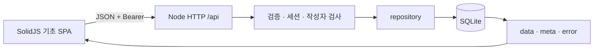

# studymidpoint · SolidJS 중간 응용 · 로그인 게시판

> 기준: [SolidJS 노션 원문](https://app.notion.com/p/40bd7dec5e2e813080f8d54cf5968ad5) · [게시판 API v1](https://app.notion.com/p/3d6d7dec5e2e8139adbfd36dd506c65e) · 문서 기준일 2026-11-20 (Asia/Seoul).

## ① 목표 한 줄

study0~10의 기술만으로 로그인·게시판·댓글 서비스를 완성한다.

## ② 📖 이론

이 단계의 범위는 SolidJS 컴포넌트·시그널·라우터·폼·createResource, Node 표준 HTTP, SQLite, 세션, 테스트, 정적 빌드다. 심화 UI 라이브러리·외부 결제·AI·WebSocket·Docker를 사용하지 않는 별도 진입점을 제공한다. 한 번에 모든 기능을 얹기 전에 작은 수직 흐름을 완성하는 것이 목적이다.

목록 화면만 완성해도 서버·DB 계약이 맞지 않으면 서비스가 아니다. 가입한 사용자가 글을 저장하고 재조회한 결과를 실제 DOM에서 확인해야 완료다. API가 택배 창구라면 DB는 창고이고 인증은 출고 권한 확인에 해당한다.

## ③ 🛠️ 실기 · 전체 코드와 줄별 설명

이 저장소는 완성 코드와 학습 노트를 함께 제공한다. 아래 파일을 지정 경로에서 읽고 실행한다. 이 단계에서 새로 다루는 파일은 생략 없이 수록하며, import되는 공통 파일은 README와 앞선 단계의 전체 코드를 따른다. 학습 진행 상황은 체크박스에 직접 기록한다.

### 목표

가입한 사용자가 학습 글을 작성·수정·삭제하고 다른 사용자와 댓글로 의견을 나눈다. 배포 후 직접 상세 URL을 열어도 동작한다.

### 기능 목록

- 회원가입·로그인·내 정보·로그아웃, 1시간 세션.
- 글 목록·검색·정렬·페이지·상세·작성·부분 수정·삭제.
- 댓글 등록·목록·작성자 삭제, 글 삭제 시 댓글 정리.
- 필드 오류·401·403·404 안내, 비밀번호 해시·텍스트 출력.

### 폴더 구조

```text
src/basic.tsx          기초 라우터와 셸
src/pages/            Posts·Detail·Editor·Login
src/components/       PostCard·PostForm
src/api.ts            통신 공통 규칙
server/basic.mjs      기초 HTTP 서버
server/auth.mjs       해시·세션·인가
server/posts.mjs      검증·DTO·목록
server/store.mjs      SQLite 저장소
tests/                계약·권한 테스트
```

### 단계별 구현 순서

1. study0 환경과 .env를 준비하고, .env.basic의 VITE_STAGE=basic을 확인한다.
2. Hello·컴포넌트·상태 실험을 끝낸 뒤 목록·상세·작성 URL을 연결한다.
3. PostForm의 save 콜백을 API에 연결하고 SQLite에서 Post를 읽고 쓴다.
4. 가입·로그인·세션 해시를 구현하고 모든 쓰기에 인증·작성자 검사를 넣는다.
5. 검색·정렬·페이지·댓글을 붙이고 오류 envelope를 통일한다.
6. `npm run build:basic` 후 `npm run start:basic`로 실행한다. 심화 진입점은 이 빌드에 포함하지 않는다. **기초 실행은 기본 SQLITE_PATH=data/midpoint.sqlite를 사용**하며 심화 DB로 덮어쓰지 않는다.

### DB·API 연동 구성도



### 1차 배포 체크리스트

- [ ] 기초 빌드로 회원가입부터 댓글 삭제까지 직접 실행한다.
- [ ] /health와 목록 GET, 상세 직접 접근, 화면 404를 점검한다.
- [ ] .env·DB·백업을 제외하고 lockfile을 보관한다.
- [ ] 배포 주소·CORS·HTTPS·영속 저장 경로를 맞춘다.
- [ ] 두 계정으로 남의 글 수정·삭제가 403인지 확인한다.

### 회고

완료 증거는 응답 상태와 화면 변화로 남긴다. “어떤 기능을 만들었나”, “어느 경계에서 막혔나”, “왜 props 구조분해와 204 처리에 주의했나”, “DB를 바꿀 때 화면은 무엇을 알아야 하나”를 각각 2문장으로 기록한다. 실제 외부 배포는 URL·검증 기록이 있을 때만 완료로 적는다.

실행 명령은 저장소 루트의 PowerShell 기준이다. 서버를 유지하는 명령 다음의 작업은 별도 터미널에서 실행한다.

```powershell
npm ci
npm run build:basic
# 자동 브라우저 확인 (별도 서버 실행 없이 테스트가 서버를 띄움)
$env:BASIC_E2E="1"
npm run test:e2e
Remove-Item Env:BASIC_E2E
$env:PUBLIC_ORIGIN="http://localhost:3000"
$env:CORS_ORIGIN="http://localhost:3000"
npm run start:basic
```

### src/basic.tsx 전체 코드

[src/basic.tsx](src/basic.tsx)

```tsx
import { render } from 'solid-js/web';
import { Router, Route, A, useNavigate, type RouteSectionProps } from '@solidjs/router';
import { Show, ErrorBoundary } from 'solid-js';
import { user, clearSession } from './session';
import { api } from './api';
import Posts from './pages/Posts';
import Detail from './pages/Detail';
import Editor from './pages/Editor';
import Login from './pages/Login';
import './styles.css';
function BasicShell(props: RouteSectionProps) {
  const navigate = useNavigate();
  async function logout() { try { await api('/api/auth/logout', { method: 'POST' }); } finally { clearSession(); navigate('/login'); } }
  return <><header class="site-header"><A href="/" class="brand">SOLID / MIDPOINT</A><nav><A href="/">게시판</A><Show when={user()} fallback={<A href="/login">로그인</A>}><span>{user()?.nickname}</span><button onClick={logout}>로그아웃</button></Show></nav></header><main><ErrorBoundary fallback={error => <p role="alert">{String(error.message)}</p>}>{props.children}</ErrorBoundary></main></>;
}
render(() => <Router root={BasicShell}><Route path="/" component={Posts} /><Route path="/login" component={Login} /><Route path="/posts/new" component={Editor} /><Route path="/posts/:id/edit" component={Editor} /><Route path="/posts/:id" component={Detail} /><Route path="*404" component={() => <h1>404 · 페이지가 없습니다.</h1>} /></Router>, document.getElementById('root')!);
```

줄 번호는 바로 위 코드의 첫 줄을 1로 센다. 빈 줄도 포함하여 실제 파일과 일치한다.

| 줄 | 해당 코드 | 설명 |
| --- | --- | --- |
| 1 | <code>import { render } from &#x27;solid-js/web&#x27;;</code> | solid-js/web에서 이 파일의 실행에 필요한 기능·타입을 가져온다. |
| 2 | <code>import { Router, Route, A, useNavigate, type RouteSectionProps } from &#x27;@solidjs/router&#x27;;</code> | @solidjs/router에서 이 파일의 실행에 필요한 기능·타입을 가져온다. |
| 3 | <code>import { Show, ErrorBoundary } from &#x27;solid-js&#x27;;</code> | solid-js에서 이 파일의 실행에 필요한 기능·타입을 가져온다. |
| 4 | <code>import { user, clearSession } from &#x27;./session&#x27;;</code> | ./session에서 이 파일의 실행에 필요한 기능·타입을 가져온다. |
| 5 | <code>import { api } from &#x27;./api&#x27;;</code> | ./api에서 이 파일의 실행에 필요한 기능·타입을 가져온다. |
| 6 | <code>import Posts from &#x27;./pages/Posts&#x27;;</code> | ./pages/Posts에서 이 파일의 실행에 필요한 기능·타입을 가져온다. |
| 7 | <code>import Detail from &#x27;./pages/Detail&#x27;;</code> | ./pages/Detail에서 이 파일의 실행에 필요한 기능·타입을 가져온다. |
| 8 | <code>import Editor from &#x27;./pages/Editor&#x27;;</code> | ./pages/Editor에서 이 파일의 실행에 필요한 기능·타입을 가져온다. |
| 9 | <code>import Login from &#x27;./pages/Login&#x27;;</code> | ./pages/Login에서 이 파일의 실행에 필요한 기능·타입을 가져온다. |
| 10 | <code>import &#x27;./styles.css&#x27;;</code> | 모듈에서 이 파일의 실행에 필요한 기능·타입을 가져온다. |
| 11 | <code>function BasicShell(props: RouteSectionProps) {</code> | 기초 SPA 라우팅의 이름 있는 동작과 인자 범위를 정의한다. |
| 12 | <code>  const navigate = useNavigate();</code> | 기초 SPA 라우팅에서 다음 처리에 사용할 값·함수·상태 참조를 준비한다. |
| 13 | <code>  async function logout() { try { await api(&#x27;/api/auth/logout&#x27;, { method: &#x27;POST&#x27; }); } finally { clearSession(); navigate(&#x27;/login&#x27;); } }</code> | 기초 SPA 라우팅: 저장·로그인 결과에 따라 다음 화면 주소로 이동한다. |
| 14 | <code>  return &lt;&gt;&lt;header class=&quot;site-header&quot;&gt;&lt;A href=&quot;/&quot; class=&quot;brand&quot;&gt;SOLID / MIDPOINT&lt;/A&gt;&lt;nav&gt;&lt;A href=&quot;/&quot;&gt;게시판&lt;/A&gt;&lt;Show when={user()} fallback={&lt;A href=&quot;/login&quot;&gt;로그인&lt;/A&gt;}&gt;&lt;span&gt;{user()?.nickname}&lt;/span&gt;&lt;button onClick={logout}&gt;로그아웃&lt;/button&gt;&lt;/Show&gt;&lt;/nav&gt;&lt;/header&gt;&lt;main&gt;&lt;ErrorBoundary fallback={error =&gt; &lt;p role=&quot;alert&quot;&gt;{String(error.message)}&lt;/p&gt;}&gt;{props.children}&lt;/ErrorBoundary&gt;&lt;/main&gt;&lt;/&gt;;</code> | 기초 SPA 라우팅: 하위 화면의 오류를 사용자가 확인할 수 있는 안내로 바꾼다. |
| 15 | <code>}</code> | 기초 SPA 라우팅의 현재 블록 또는 선언을 닫는다. |
| 16 | <code>render(() =&gt; &lt;Router root={BasicShell}&gt;&lt;Route path=&quot;/&quot; component={Posts} /&gt;&lt;Route path=&quot;/login&quot; component={Login} /&gt;&lt;Route path=&quot;/posts/new&quot; component={Editor} /&gt;&lt;Route path=&quot;/posts/:id/edit&quot; component={Editor} /&gt;&lt;Route path=&quot;/posts/:id&quot; component={Detail} /&gt;&lt;Route path=&quot;*404&quot; component={() =&gt; &lt;h1&gt;404 · 페이지가 없습니다.&lt;/h1&gt;} /&gt;&lt;/Router&gt;, document.getElementById(&#x27;root&#x27;)!);</code> | 기초 SPA 라우팅: 주소 패턴과 렌더링 컴포넌트를 연결한다. |

### server/basic.mjs 전체 코드

[server/basic.mjs](server/basic.mjs)

```javascript
// midpoint: study0~10의 인증·CRUD·SQLite·정적 배포만 사용한다.
import { createServer } from 'node:http';
import { readFile } from 'node:fs/promises';
import { resolve, extname, sep } from 'node:path';
import { openStore, repository } from './store.mjs';
import { fail, send, requestId, errorResponse, readJson, numericId, text } from './errors.mjs';
import { authenticate, signUp, publicUser, verifyPassword, issueSession, owner } from './auth.mjs';
import { validatePost, postDto, listPosts } from './posts.mjs';
const store = await openStore({ path: process.env.SQLITE_PATH || 'data/midpoint.sqlite' });
const repo = repository(store); const origin = process.env.CORS_ORIGIN || 'http://localhost:5173';
const attempts = new Map();
function throttle(key) {
  const now = Date.now(); const current = attempts.get(key) || { count: 0, until: now + 60000 };
  if (current.until < now) { current.count = 0; current.until = now + 60000; }
  attempts.set(key, current); if (++current.count > 20) fail(429, 'RATE_LIMITED', '잠시 후 다시 시도하세요.');
}
const required = async id => { const post = await repo.get('posts', id); if (!post) fail(404, 'NOT_FOUND', '없는 글입니다.'); return post; };
const server = createServer(async (req, res) => {
  const id = requestId(req); res.setHeader('X-Request-Id', id); res.setHeader('X-Content-Type-Options', 'nosniff');
  const path = new URL(req.url, 'http://localhost');
  try {
    if (req.headers.origin && req.headers.origin !== origin) fail(403, 'FORBIDDEN', 'Origin을 확인하세요.');
    if (req.headers.origin) { res.setHeader('Access-Control-Allow-Origin', origin); res.setHeader('Vary', 'Origin'); }
    if (req.method === 'OPTIONS') { res.setHeader('Access-Control-Allow-Methods', 'GET,POST,PATCH,DELETE'); res.setHeader('Access-Control-Allow-Headers', 'Content-Type,Authorization'); return send(res, 204); }
    await repo.serial(async () => {
      const method = req.method; const auth = () => authenticate(repo, req.headers.authorization);
      if (path.pathname === '/health' && method === 'GET') return send(res, 200, { status: 'ok' });
      if (path.pathname === '/api/auth/signup' && method === 'POST') { throttle(req.socket.remoteAddress); return send(res, 201, { data: publicUser(await signUp(repo, await readJson(req))) }); }
      if (path.pathname === '/api/auth/login' && method === 'POST') {
        throttle(req.socket.remoteAddress); const input = await readJson(req); const email = text(input.email, 'email', 254).toLowerCase(); const password = text(input.password, 'password', 128);
        const user = (await repo.all('users')).find(u => u.email === email);
        if (!user || !await verifyPassword(password, user.passwordHash)) fail(401, 'INVALID_CREDENTIALS', '로그인 정보를 확인하세요.');
        return send(res, 200, { data: await issueSession(repo, user) });
      }
      if (path.pathname === '/api/auth/me' && method === 'GET') return send(res, 200, { data: publicUser((await auth()).user) });
      if (path.pathname === '/api/auth/logout' && method === 'POST') { await repo.delete('sessions', (await auth()).session.id); return send(res, 204); }
      if (path.pathname === '/api/posts' && method === 'GET') return send(res, 200, await listPosts(repo, path.searchParams));
      if (path.pathname === '/api/posts' && method === 'POST') {
        const { user } = await auth(); const input = validatePost(await readJson(req)); const now = new Date().toISOString();
        const post = await repo.insert('posts', { ...input, authorId: user.id, createdAt: now, updatedAt: now });
        res.setHeader('Location', `/api/posts/${post.id}`); return send(res, 201, { data: await postDto(repo, post) });
      }
      const match = path.pathname.match(/^\/api\/posts\/([^/]+)$/);
      if (match) {
        const post = await required(numericId(match[1]));
        if (method === 'GET') return send(res, 200, { data: await postDto(repo, post) });
        if (method === 'PATCH' || method === 'DELETE') {
          owner(post, (await auth()).user);
          if (method === 'PATCH') { const result = await repo.put('posts', { ...post, ...validatePost(await readJson(req), true), updatedAt: new Date().toISOString() }); return send(res, 200, { data: await postDto(repo, result) }); }
          for (const c of await repo.all('comments')) if (c.postId === post.id) await repo.delete('comments', c.id);
          await repo.delete('posts', post.id); return send(res, 204);
        }
      }
      const comments = path.pathname.match(/^\/api\/posts\/([^/]+)\/comments$/);
      if (comments) {
        const post = await required(numericId(comments[1]));
        if (method === 'GET') return send(res, 200, { data: await Promise.all((await repo.all('comments')).filter(c => c.postId === post.id).map(async c => ({ ...c, author: publicUser(await repo.get('users', c.authorId)) }))) });
        if (method === 'POST') { const { user } = await auth(); const input = await readJson(req); const comment = await repo.insert('comments', { postId: post.id, authorId: user.id, body: text(input.body, 'body', 2000), createdAt: new Date().toISOString() }); return send(res, 201, { data: { ...comment, author: publicUser(user) } }); }
      }
      const comment = path.pathname.match(/^\/api\/comments\/([^/]+)$/);
      if (comment && method === 'DELETE') { const row = await repo.get('comments', numericId(comment[1])); if (!row) fail(404, 'NOT_FOUND', '없는 댓글입니다.'); owner(row, (await auth()).user); await repo.delete('comments', row.id); return send(res, 204); }
      if (method === 'GET' && !path.pathname.startsWith('/api')) {
        const root = resolve('dist'); let file = resolve(root, '.' + decodeURIComponent(path.pathname));
        if (file !== root && !file.startsWith(root + sep)) fail(404, 'NOT_FOUND', '없는 경로입니다.');
        if (!extname(file)) file = resolve(root, 'index.html');
        try { const bytes = await readFile(file); res.setHeader('Content-Type', ({ '.html': 'text/html; charset=utf-8', '.css': 'text/css', '.js': 'text/javascript' })[extname(file)] || 'application/octet-stream'); return res.end(bytes); } catch {}
      }
      fail(404, 'NOT_FOUND', '없는 경로입니다.');
    });
  } catch (error) { errorResponse(res, error, id); }
});
server.listen(Number(process.env.PORT || 3000), process.env.HOST || '127.0.0.1', () => console.log('midpoint API 준비 완료'));
for (const signal of ['SIGINT', 'SIGTERM']) process.once(signal, () => server.close(async () => { await store.close(); process.exit(0); }));
```

줄 번호는 바로 위 코드의 첫 줄을 1로 센다. 빈 줄도 포함하여 실제 파일과 일치한다.

| 줄 | 해당 코드 | 설명 |
| --- | --- | --- |
| 1 | <code>// midpoint: study0~10의 인증·CRUD·SQLite·정적 배포만 사용한다.</code> | midpoint: study0~10의 인증·CRUD·SQLite·정적 배포만 사용한다. |
| 2 | <code>import { createServer } from &#x27;node:http&#x27;;</code> | node:http에서 이 파일의 실행에 필요한 기능·타입을 가져온다. |
| 3 | <code>import { readFile } from &#x27;node:fs/promises&#x27;;</code> | node:fs/promises에서 이 파일의 실행에 필요한 기능·타입을 가져온다. |
| 4 | <code>import { resolve, extname, sep } from &#x27;node:path&#x27;;</code> | node:path에서 이 파일의 실행에 필요한 기능·타입을 가져온다. |
| 5 | <code>import { openStore, repository } from &#x27;./store.mjs&#x27;;</code> | ./store.mjs에서 이 파일의 실행에 필요한 기능·타입을 가져온다. |
| 6 | <code>import { fail, send, requestId, errorResponse, readJson, numericId, text } from &#x27;./errors.mjs&#x27;;</code> | ./errors.mjs에서 이 파일의 실행에 필요한 기능·타입을 가져온다. |
| 7 | <code>import { authenticate, signUp, publicUser, verifyPassword, issueSession, owner } from &#x27;./auth.mjs&#x27;;</code> | ./auth.mjs에서 이 파일의 실행에 필요한 기능·타입을 가져온다. |
| 8 | <code>import { validatePost, postDto, listPosts } from &#x27;./posts.mjs&#x27;;</code> | ./posts.mjs에서 이 파일의 실행에 필요한 기능·타입을 가져온다. |
| 9 | <code>const store = await openStore({ path: process.env.SQLITE_PATH &#124;&#124; &#x27;data/midpoint.sqlite&#x27; });</code> | 기초 HTTP 서비스에서 다음 처리에 사용할 값·함수·상태 참조를 준비한다. |
| 10 | <code>const repo = repository(store); const origin = process.env.CORS_ORIGIN &#124;&#124; &#x27;http://localhost:5173&#x27;;</code> | 기초 HTTP 서비스에서 다음 처리에 사용할 값·함수·상태 참조를 준비한다. |
| 11 | <code>const attempts = new Map();</code> | 기초 HTTP 서비스에서 다음 처리에 사용할 값·함수·상태 참조를 준비한다. |
| 12 | <code>function throttle(key) {</code> | 기초 HTTP 서비스의 이름 있는 동작과 인자 범위를 정의한다. |
| 13 | <code>  const now = Date.now(); const current = attempts.get(key) &#124;&#124; { count: 0, until: now + 60000 };</code> | 기초 HTTP 서비스에서 다음 처리에 사용할 값·함수·상태 참조를 준비한다. |
| 14 | <code>  if (current.until &lt; now) { current.count = 0; current.until = now + 60000; }</code> | 기초 HTTP 서비스에서 조건에 따라 처리 경로를 선택하거나 조기 종료한다. |
| 15 | <code>  attempts.set(key, current); if (++current.count &gt; 20) fail(429, &#x27;RATE_LIMITED&#x27;, &#x27;잠시 후 다시 시도하세요.&#x27;);</code> | 기초 HTTP 서비스: 규칙 위반을 HTTP 상태·code·필드 오류로 중단한다. |
| 16 | <code>}</code> | 기초 HTTP 서비스의 현재 블록 또는 선언을 닫는다. |
| 17 | <code>const required = async id =&gt; { const post = await repo.get(&#x27;posts&#x27;, id); if (!post) fail(404, &#x27;NOT_FOUND&#x27;, &#x27;없는 글입니다.&#x27;); return post; };</code> | 기초 HTTP 서비스: id에 해당하는 저장 레코드를 조회한다. |
| 18 | <code>const server = createServer(async (req, res) =&gt; {</code> | 기초 HTTP 서비스에서 다음 처리에 사용할 값·함수·상태 참조를 준비한다. |
| 19 | <code>  const id = requestId(req); res.setHeader(&#x27;X-Request-Id&#x27;, id); res.setHeader(&#x27;X-Content-Type-Options&#x27;, &#x27;nosniff&#x27;);</code> | 기초 HTTP 서비스: HTTP 응답의 보안·형식·추적·캐시 헤더를 설정한다. |
| 20 | <code>  const path = new URL(req.url, &#x27;http://localhost&#x27;);</code> | 기초 HTTP 서비스: 고정 base에 경로·쿼리를 연결하거나 URL 부분을 안전하게 해석한다. |
| 21 | <code>  try {</code> | 기초 HTTP 서비스의 앞서 선언한 데이터·객체·출력 구조에 이 줄의 값을 연결한다. |
| 22 | <code>    if (req.headers.origin &amp;&amp; req.headers.origin !== origin) fail(403, &#x27;FORBIDDEN&#x27;, &#x27;Origin을 확인하세요.&#x27;);</code> | 기초 HTTP 서비스: 규칙 위반을 HTTP 상태·code·필드 오류로 중단한다. |
| 23 | <code>    if (req.headers.origin) { res.setHeader(&#x27;Access-Control-Allow-Origin&#x27;, origin); res.setHeader(&#x27;Vary&#x27;, &#x27;Origin&#x27;); }</code> | 기초 HTTP 서비스: HTTP 응답의 보안·형식·추적·캐시 헤더를 설정한다. |
| 24 | <code>    if (req.method === &#x27;OPTIONS&#x27;) { res.setHeader(&#x27;Access-Control-Allow-Methods&#x27;, &#x27;GET,POST,PATCH,DELETE&#x27;); res.setHeader(&#x27;Access-Control-Allow-Headers&#x27;, &#x27;Content-Type,Authorization&#x27;); return send(res, 204); }</code> | 기초 HTTP 서비스: HTTP 응답의 보안·형식·추적·캐시 헤더를 설정한다. |
| 25 | <code>    await repo.serial(async () =&gt; {</code> | 기초 HTTP 서비스: 단일 서버 프로세스에서 데이터 작업 순서를 보장한다. |
| 26 | <code>      const method = req.method; const auth = () =&gt; authenticate(repo, req.headers.authorization);</code> | 기초 HTTP 서비스: Bearer 세션 해시·만료·사용자를 서버에서 확인한다. |
| 27 | <code>      if (path.pathname === &#x27;/health&#x27; &amp;&amp; method === &#x27;GET&#x27;) return send(res, 200, { status: &#x27;ok&#x27; });</code> | 기초 HTTP 서비스: 현재 분기의 상태 코드와 JSON 또는 빈 응답을 전송한다. |
| 28 | <code>      if (path.pathname === &#x27;/api/auth/signup&#x27; &amp;&amp; method === &#x27;POST&#x27;) { throttle(req.socket.remoteAddress); return send(res, 201, { data: publicUser(await signUp(repo, await readJson(req))) }); }</code> | 기초 HTTP 서비스: 현재 분기의 상태 코드와 JSON 또는 빈 응답을 전송한다. |
| 29 | <code>      if (path.pathname === &#x27;/api/auth/login&#x27; &amp;&amp; method === &#x27;POST&#x27;) {</code> | 기초 HTTP 서비스에서 조건에 따라 처리 경로를 선택하거나 조기 종료한다. |
| 30 | <code>        throttle(req.socket.remoteAddress); const input = await readJson(req); const email = text(input.email, &#x27;email&#x27;, 254).toLowerCase(); const password = text(input.password, &#x27;password&#x27;, 128);</code> | 기초 HTTP 서비스의 앞서 선언한 데이터·객체·출력 구조에 이 줄의 값을 연결한다. |
| 31 | <code>        const user = (await repo.all(&#x27;users&#x27;)).find(u =&gt; u.email === email);</code> | 기초 HTTP 서비스: bucket의 레코드를 읽어 검증·필터·조회에 사용한다. |
| 32 | <code>        if (!user &#124;&#124; !await verifyPassword(password, user.passwordHash)) fail(401, &#x27;INVALID_CREDENTIALS&#x27;, &#x27;로그인 정보를 확인하세요.&#x27;);</code> | 기초 HTTP 서비스: 규칙 위반을 HTTP 상태·code·필드 오류로 중단한다. |
| 33 | <code>        return send(res, 200, { data: await issueSession(repo, user) });</code> | 기초 HTTP 서비스: 현재 분기의 상태 코드와 JSON 또는 빈 응답을 전송한다. |
| 34 | <code>      }</code> | 기초 HTTP 서비스의 현재 블록 또는 선언을 닫는다. |
| 35 | <code>      if (path.pathname === &#x27;/api/auth/me&#x27; &amp;&amp; method === &#x27;GET&#x27;) return send(res, 200, { data: publicUser((await auth()).user) });</code> | 기초 HTTP 서비스: 현재 분기의 상태 코드와 JSON 또는 빈 응답을 전송한다. |
| 36 | <code>      if (path.pathname === &#x27;/api/auth/logout&#x27; &amp;&amp; method === &#x27;POST&#x27;) { await repo.delete(&#x27;sessions&#x27;, (await auth()).session.id); return send(res, 204); }</code> | 기초 HTTP 서비스: 지정한 bucket과 id의 레코드를 제거한다. |
| 37 | <code>      if (path.pathname === &#x27;/api/posts&#x27; &amp;&amp; method === &#x27;GET&#x27;) return send(res, 200, await listPosts(repo, path.searchParams));</code> | 기초 HTTP 서비스: 현재 분기의 상태 코드와 JSON 또는 빈 응답을 전송한다. |
| 38 | <code>      if (path.pathname === &#x27;/api/posts&#x27; &amp;&amp; method === &#x27;POST&#x27;) {</code> | 기초 HTTP 서비스에서 조건에 따라 처리 경로를 선택하거나 조기 종료한다. |
| 39 | <code>        const { user } = await auth(); const input = validatePost(await readJson(req)); const now = new Date().toISOString();</code> | 기초 HTTP 서비스: title·body·tags가 공통 게시글 입력 규칙을 만족하는지 검사한다. |
| 40 | <code>        const post = await repo.insert(&#x27;posts&#x27;, { ...input, authorId: user.id, createdAt: now, updatedAt: now });</code> | 기초 HTTP 서비스: 도메인 레코드에 숫자 id를 부여하여 저장한다. |
| 41 | <code>        res.setHeader(&#x27;Location&#x27;, `/api/posts/${post.id}`); return send(res, 201, { data: await postDto(repo, post) });</code> | 기초 HTTP 서비스: HTTP 응답의 보안·형식·추적·캐시 헤더를 설정한다. |
| 42 | <code>      }</code> | 기초 HTTP 서비스의 현재 블록 또는 선언을 닫는다. |
| 43 | <code>      const match = path.pathname.match(/^\/api\/posts\/([^/]+)$/);</code> | 기초 HTTP 서비스에서 다음 처리에 사용할 값·함수·상태 참조를 준비한다. |
| 44 | <code>      if (match) {</code> | 기초 HTTP 서비스에서 조건에 따라 처리 경로를 선택하거나 조기 종료한다. |
| 45 | <code>        const post = await required(numericId(match[1]));</code> | 기초 HTTP 서비스에서 다음 처리에 사용할 값·함수·상태 참조를 준비한다. |
| 46 | <code>        if (method === &#x27;GET&#x27;) return send(res, 200, { data: await postDto(repo, post) });</code> | 기초 HTTP 서비스: 현재 분기의 상태 코드와 JSON 또는 빈 응답을 전송한다. |
| 47 | <code>        if (method === &#x27;PATCH&#x27; &#124;&#124; method === &#x27;DELETE&#x27;) {</code> | 기초 HTTP 서비스에서 조건에 따라 처리 경로를 선택하거나 조기 종료한다. |
| 48 | <code>          owner(post, (await auth()).user);</code> | 기초 HTTP 서비스: 현재 사용자와 작성자를 비교하여 변경 권한을 확인한다. |
| 49 | <code>          if (method === &#x27;PATCH&#x27;) { const result = await repo.put(&#x27;posts&#x27;, { ...post, ...validatePost(await readJson(req), true), updatedAt: new Date().toISOString() }); return send(res, 200, { data: await postDto(repo, result) }); }</code> | 기초 HTTP 서비스: title·body·tags가 공통 게시글 입력 규칙을 만족하는지 검사한다. |
| 50 | <code>          for (const c of await repo.all(&#x27;comments&#x27;)) if (c.postId === post.id) await repo.delete(&#x27;comments&#x27;, c.id);</code> | 기초 HTTP 서비스: 지정한 bucket과 id의 레코드를 제거한다. |
| 51 | <code>          await repo.delete(&#x27;posts&#x27;, post.id); return send(res, 204);</code> | 기초 HTTP 서비스: 지정한 bucket과 id의 레코드를 제거한다. |
| 52 | <code>        }</code> | 기초 HTTP 서비스의 현재 블록 또는 선언을 닫는다. |
| 53 | <code>      }</code> | 기초 HTTP 서비스의 현재 블록 또는 선언을 닫는다. |
| 54 | <code>      const comments = path.pathname.match(/^\/api\/posts\/([^/]+)\/comments$/);</code> | 기초 HTTP 서비스에서 다음 처리에 사용할 값·함수·상태 참조를 준비한다. |
| 55 | <code>      if (comments) {</code> | 기초 HTTP 서비스에서 조건에 따라 처리 경로를 선택하거나 조기 종료한다. |
| 56 | <code>        const post = await required(numericId(comments[1]));</code> | 기초 HTTP 서비스에서 다음 처리에 사용할 값·함수·상태 참조를 준비한다. |
| 57 | <code>        if (method === &#x27;GET&#x27;) return send(res, 200, { data: await Promise.all((await repo.all(&#x27;comments&#x27;)).filter(c =&gt; c.postId === post.id).map(async c =&gt; ({ ...c, author: publicUser(await repo.get(&#x27;users&#x27;, c.authorId)) }))) });</code> | 기초 HTTP 서비스: id에 해당하는 저장 레코드를 조회한다. |
| 58 | <code>        if (method === &#x27;POST&#x27;) { const { user } = await auth(); const input = await readJson(req); const comment = await repo.insert(&#x27;comments&#x27;, { postId: post.id, authorId: user.id, body: text(input.body, &#x27;body&#x27;, 2000), createdAt: new Date().toISOString() }); return send(res, 201, { data: { ...comment, author: publicUser(user) } }); }</code> | 기초 HTTP 서비스: 도메인 레코드에 숫자 id를 부여하여 저장한다. |
| 59 | <code>      }</code> | 기초 HTTP 서비스의 현재 블록 또는 선언을 닫는다. |
| 60 | <code>      const comment = path.pathname.match(/^\/api\/comments\/([^/]+)$/);</code> | 기초 HTTP 서비스에서 다음 처리에 사용할 값·함수·상태 참조를 준비한다. |
| 61 | <code>      if (comment &amp;&amp; method === &#x27;DELETE&#x27;) { const row = await repo.get(&#x27;comments&#x27;, numericId(comment[1])); if (!row) fail(404, &#x27;NOT_FOUND&#x27;, &#x27;없는 댓글입니다.&#x27;); owner(row, (await auth()).user); await repo.delete(&#x27;comments&#x27;, row.id); return send(res, 204); }</code> | 기초 HTTP 서비스: 현재 사용자와 작성자를 비교하여 변경 권한을 확인한다. |
| 62 | <code>      if (method === &#x27;GET&#x27; &amp;&amp; !path.pathname.startsWith(&#x27;/api&#x27;)) {</code> | 기초 HTTP 서비스에서 조건에 따라 처리 경로를 선택하거나 조기 종료한다. |
| 63 | <code>        const root = resolve(&#x27;dist&#x27;); let file = resolve(root, &#x27;.&#x27; + decodeURIComponent(path.pathname));</code> | 기초 HTTP 서비스에서 다음 처리에 사용할 값·함수·상태 참조를 준비한다. |
| 64 | <code>        if (file !== root &amp;&amp; !file.startsWith(root + sep)) fail(404, &#x27;NOT_FOUND&#x27;, &#x27;없는 경로입니다.&#x27;);</code> | 기초 HTTP 서비스: 규칙 위반을 HTTP 상태·code·필드 오류로 중단한다. |
| 65 | <code>        if (!extname(file)) file = resolve(root, &#x27;index.html&#x27;);</code> | 기초 HTTP 서비스에서 조건에 따라 처리 경로를 선택하거나 조기 종료한다. |
| 66 | <code>        try { const bytes = await readFile(file); res.setHeader(&#x27;Content-Type&#x27;, ({ &#x27;.html&#x27;: &#x27;text/html; charset=utf-8&#x27;, &#x27;.css&#x27;: &#x27;text/css&#x27;, &#x27;.js&#x27;: &#x27;text/javascript&#x27; })[extname(file)] &#124;&#124; &#x27;application/octet-stream&#x27;); return res.end(bytes); } catch {}</code> | 기초 HTTP 서비스: HTTP 응답의 보안·형식·추적·캐시 헤더를 설정한다. |
| 67 | <code>      }</code> | 기초 HTTP 서비스의 현재 블록 또는 선언을 닫는다. |
| 68 | <code>      fail(404, &#x27;NOT_FOUND&#x27;, &#x27;없는 경로입니다.&#x27;);</code> | 기초 HTTP 서비스: 규칙 위반을 HTTP 상태·code·필드 오류로 중단한다. |
| 69 | <code>    });</code> | 기초 HTTP 서비스의 현재 블록 또는 선언을 닫는다. |
| 70 | <code>  } catch (error) { errorResponse(res, error, id); }</code> | 기초 HTTP 서비스의 실패를 잡아 오류 안내·복구·상태 갱신으로 전환한다. |
| 71 | <code>});</code> | 기초 HTTP 서비스의 현재 블록 또는 선언을 닫는다. |
| 72 | <code>server.listen(Number(process.env.PORT &#124;&#124; 3000), process.env.HOST &#124;&#124; &#x27;127.0.0.1&#x27;, () =&gt; console.log(&#x27;midpoint API 준비 완료&#x27;));</code> | 기초 HTTP 서비스의 앞서 선언한 데이터·객체·출력 구조에 이 줄의 값을 연결한다. |
| 73 | <code>for (const signal of [&#x27;SIGINT&#x27;, &#x27;SIGTERM&#x27;]) process.once(signal, () =&gt; server.close(async () =&gt; { await store.close(); process.exit(0); }));</code> | 기초 HTTP 서비스의 각 항목·프레임·작업을 순서대로 처리한다. |

## ④ 🔗 연동 포인트

기초 서비스의 Post/Meta/Error 계약을 동결한다. study11은 이 계약을 유지한 채 서버 저장소만 교체한다. 심화로 돌아올 때 npm run build를 다시 실행한다.

## ⑤ 오류 노트

| 증상 | 원인 | 해결 |
| --- | --- | --- |
| AI 메뉴가 보임 | 심화 빌드를 실행 | build:basic으로 다시 빌드 |
| 글이 사라진 듯 보임 | 기초·심화 SQLite 파일이 다름 | 실행 모드와 SQLITE_PATH 확인 |
| 수정은 막았는데 삭제 가능 | DELETE에 owner 누락 | 모든 쓰기에 동일 인가 적용 |

## ⑥ 직접 해보기

1. 가입→글→댓글→수정→삭제 전체 시나리오를 두 계정으로 실행한다.
2. 1차 배포 전후 데이터 영속성을 확인한다.
3. DB를 재생성 가능한 가짜 데이터와 보존할 데이터로 나눈다.

## ⑦ ☐ 체크리스트

- [ ] study0~10만 사용하는 기초 실행 경로를 확인했다.
- [ ] 로그인·CRUD·댓글·권한·오류 흐름을 연결했다.
- [ ] 구성도·배포 점검·회고를 작성했다.

## ⑧ 다음 단계 연결 문장

study0~10의 기술만으로 로그인·게시판·댓글 서비스를 완성한다를 마쳤다면 [study11.md](study11.md)에서 이어 간다.

공식 자료: [SolidJS 1.x 소스](https://github.com/solidjs/solid/tree/v1.9.20), [Solid Router](https://docs.solidjs.com/solid-router/getting-started/installation-and-setup), [Node SQLite](https://nodejs.org/docs/latest-v24.x/api/sqlite.html). 최신 문서와 설치 버전이 다를 수 있어 package-lock.json을 실행 기준으로 삼는다.
